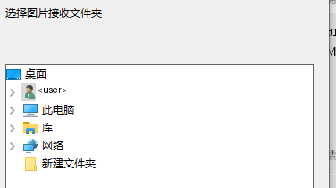

# PhotoBeam Stage 5 证据（使用场景全流程核对 + 交互断裂修复）

- 任务 marker：`lam-20261102-045427-fcbd`（延续）
- 工作目录：`C:\Users\<user>\Project\PhotoBeam`
- 分支：`feature/stage5-ux`
- 实测环境：PC `<PC-NAME>` / 192.168.0.<PHONE-IP>；手机 <PHONE-MODEL> / Android 13 / SDK 33
- 起点：Stage 4（FGS 后台自起修复）已交付并实机复验通过

本轮起因：**用户要求逐交互步骤复核「使用场景 / 使用方法 / 预期效果」**。
复核方式 = 读全部 Android UI 代码 + 全量只读梳理 PC 端 11 个 `.go` 源文件 + 协议 v1.3 全文对照。

---

## 0. 结论

**日常闭环（截图 → 自动同步 → 弹窗 → Ctrl+V → 60 秒还原）成立且实测通过；
首次配对链在 PC 端断了一环——用户被要求核对一个电脑上根本不显示的数字。**

| 类别 | 数量 | 处置 |
|---|---|---|
| P0 功能级断裂 | 4 | 全部修复 |
| P1 体验级断裂 | 7 | 全部修复 |
| P2 边界与协议偏离 | 3 | 2 项修复 + 1 项按决策移入遗留 |
| 协议条款与实测冲突 | 12 | 登记在 `protocol-v1.md` §11，协议升级至 **v1.4** |
| **第二轮用户实机反馈** | **2** | **全部修复**（配对向导窗重复 / 文件夹选择器空白），见 §5.8；新增协议偏离 3 条 → 协议升级至 **v1.5** |
| **第三轮：核对清单回核** | **6** | **全部修复并实测**（配对失败文案 / 逐张到达回执 / 剪贴板还原语义 / 跳过原因可区分 / 托盘配置入口 / ① 按钮文案），见 §5.9；新增协议偏离 1 条 |
| **第四轮：发现机制回核** | **2** | **全部修复**（按指纹甄别应答 / 手工输入电脑 IP 兜底落地），见 §5.10；新增协议偏离 1 条 |

---

## 1. 全流程逐步复核（结论：哪些通、哪些断）

### 1.1 场景 A｜首次安装

| 步 | 用户动作 | 系统行为 | 用户可见 | 判定 |
|---|---|---|---|---|
| A1 | 双击 `PhotoBeam.exe` | 建 `%LOCALAPPDATA%\PhotoBeam\` → 生成 Ed25519+X25519 身份 → TCP 5416→5436 探测占用 → UDP 5416 绑定 → 异步 UAC 写防火墙 → 托盘出现图标 | **无主窗口**；一次 UAC；托盘一个 P | ⚠ 协议 §8 要求向导窗，**无** |
| A2 | UAC 点「否」 | 日志 + 消息框 | 「防火墙规则未创建（UAC 被取消）…」 | ✅ |
| A3 | 端口被占 | `go messageBox` + 立即 `os.Exit(1)` | **大概率什么都看不到**（进程先退）；UDP 分支**连日志都没有** | ❌ **P0** |
| A4 | 手机装 APK 打开 | `onCreate` 自动申请权限 | 权限框 + 5 个按钮 + 状态区 | ⚠ ① 按钮是重复入口 |
| A5 | 看状态区 | 读 prefs | 「未配对 / 0 张 / 未运行 / 图标：无 / 后台常驻：未放行」 | ✅ 如实 |
| A6 | 点 ⑤ 电池优化 | 依次试 4 个 intent | 跳系统设置；回读「已放行」 | ⚠ 文案"图标会时有时无"不准确 |
| A7 | 点 ② 配对 | 发现 → 握手 → 弹 SAS 对话框 | 手机：「请在电脑上核对数字：xxxxxx」 | ❌ **P0 断链** |
| A8 | **在电脑上找数字** | PC 只 `logf("配对模式 SAS=%s…")` | **屏幕上什么都没有** | ❌ **P0** |
| A9 | 盲点「一致」 | 发 pair_confirm → 常数时间比对 + 验签 | 成功：手机提示 + PC 消息框「已与 <手机名> 完成配对」 | ⚠ PC 端**没有**「不一致」动作 |
| A10 | 15 秒无响应 | latch 超时 → 视为不一致 | 「配对失败：<原始异常>」 | ⚠ 原始异常直抛；15s 偏短 |

### 1.2 场景 B｜日常使用（这一段是通的）

| 步 | 用户动作 | 用户可见 | 判定 |
|---|---|---|---|
| B1 | 手机截图 | 状态栏 P 变波点动画（4 帧 180ms） | ✅ |
| B2 | 什么都不做 | PC 落盘 `Received\<毫秒>_<原名>.jpg` | ✅ 字节级一致（Stage 4 实测） |
| B3 | 什么都不做 | PC 弹窗「已同步到剪贴板 / **1730000000000_photo.jpg** / Ctrl+V 可粘贴 · 60 秒后还原」+ 缩略图 | ⚠ 显示的是**落盘名**不是原名；无「已保存到目录」 |
| B4 | PC 上 Ctrl+V | 粘贴出图 | ✅ |
| B5 | 什么都不做 | 60 秒后自动还原 | ✅ |
| B6 | 手机上等 | **手机毫无「已到电脑」的提示** | ⚠ 成功反馈只在 PC 侧 |
| B7 | 连发多张 | 新弹窗顶掉旧弹窗；剪贴板单槽位 | ⚠ 不排队；还原可能还原回上一张 PhotoBeam 图 |

### 1.3 场景 C｜出问题的自助能力

| 能问什么 | 手机端 | PC 端 |
|---|---|---|
| 配没配对 / 队列几张 / 服务在不在 / 图标模式 / 后台允不允许 | ✅ 状态区 5 行 | — |
| IP / 端口 / 指纹 | ❌ **无任何诊断入口** | ✅ tooltip + 诊断 |
| 日志 | ❌ | ✅ `logs\pc.log`（无级别、无轮转） |
| 网络自检四件套 | ❌ | ❌ **协议 §8:289 要求，一项未实现** |

### 1.4 场景 D｜改配置 / 停服务

- 手机端**没有任何"停止同步服务"入口**（`ACTION_STOP` 定义了、实现了，**但 UI 里没人发它**）。
- PC 端只能手改 `config.json`，改完得重启进程——**托盘没有重启入口**。
- 托盘**左键与右键行为相同**（systray 默认），没有独立左键动作。

---

## 2. 断点清单（修复前状态）

### P0 — 功能级断裂

| # | 现象 | 根因 | 位置 |
|---|---|---|---|
| 1 | 手机让用户核对 6 位码，**PC 上没有** | SAS 只进日志，无向导窗 | `pc/server.go:262` |
| 2 | 端口被占 → 双击闪退、无提示 | `go messageBox` + `os.Exit(1)` 竞态 | `pc/main.go:46-53`、`pc/util.go:110` |
| 3 | 无法停止同步服务 | `ACTION_STOP` 无 UI 入口 | `SenderService.kt:33,200` |
| 4 | Android 14+ 选「部分照片」→ 永远提示权限未授予 | 未处理 `READ_MEDIA_VISUAL_USER_SELECTED` 三态 | `MainActivity.kt:51-53,176-179` |

### P1 — 体验级断裂

| # | 现象 | 位置 |
|---|---|---|
| 5 | ③「立即同步」无完成回执，状态不刷新 | `MainActivity.kt:100-103` |
| 6 | 手机端零诊断能力 | `MainActivity.kt` |
| 7 | 弹窗显示落盘名（毫秒前缀），无「已保存到目录」 | `pc/server.go:489,326` |
| 8 | 复制诊断信息覆盖剪贴板且不还原 | `pc/clipboard_windows.go:297-314` |
| 9 | 按钮编号 ①②③+无编号+④ 混乱；README 未提 ④ 却承诺「两端核对 6 位数字」 | `MainActivity.kt:81-85`、`README.md` |
| 10 | 磁盘满/IO 失败/扩展名拒绝/超大文件 → 只回 ACK，PC 端零提示 | `pc/server.go:443-467` |
| 11 | 向导窗选目录、网络自检四件套、环形日志、崩溃 dump 全未实现 | 协议 §8:287-299 |

### P2

| # | 现象 | 处置 |
|---|---|---|
| 12 | Android 14+ FGS 超时未处理（无 `onTimeout`）→ 服务被停 → 通知被撤 → **图标再次整体消失**，只能等心跳（≤5 分钟） | 修复 |
| 13 | `BootReceiver` 广播内直起服务，与协议 §7.6「只起闹钟」冲突 | **保留实测行为，改协议**（§11 偏离 4） |
| 14 | `USE_EXACT_ALARM` 与协议 §0「不申请、不使用」冲突 | **保留实测行为，改协议**（§11 偏离 3） |
| 15 | 计划任务看门狗 | **按决策不实现**，登记为协议 §10 延后项 |

---

## 3. 协议条款与实现差异汇总（核对产出）

| # | 协议要求 | 实现实际 | 位置 |
|---|---|---|---|
| 1 | §3.2:124 Receiver 向导窗展示 SAS | 仅日志 | `pc/server.go:262` |
| 2 | §8:287 向导窗选保存文件夹 | 无；只能手改 `config.json` | `pc/config.go:66-84` |
| 3 | §3.2:122 配对记录在 `devices.json` | 实为 `config.json` 的 `devices[]` | `pc/config.go:36-45` |
| 4 | §3.2:129 Receiver 显示「用户已拒绝配对」 | 文案为「手机端已拒绝配对」；PC 端无「不一致」动作 | `pc/server.go:280-283` |
| 5 | §5.2:198 ACK `reason:"ext_rejected"` | 发 `invalid_name` | `pc/server.go:446` |
| 6 | §8:289-292 网络自检四件套 | 诊断仅含端口/防火墙存在性/设备数/日志尾部 | `pc/main.go:137-159` |
| 7 | §8:299 环形 200 条 + 崩溃写退出码与最近 200 条 | 无环形；panic 仅写一行 | `pc/util.go:83-93`、`pc/main.go:18-24` |
| 8 | §8:296-298 计划任务看门狗每 5 分钟拉起 | 未实现 | `pc/main.go:61-72,197-213` |

---

## 4. 本轮修复

> 详细改动清单见各子任务的施工记录；此处只列结论与验证。

### 4.1 PC 端（Go，`pc\`）

| 项 | 修复 | 状态 |
|---|---|---|
| PC-1 | 新建**配对向导窗**：显示 6 位 SAS 码 + 本机指纹 + 手机设备名 + 「一致 / 不一致」按钮 + 超时自动关闭；「不一致」**真的发 `pair_reject`** | ✅ 已验收 |
| PC-2 | 向导窗内 + 托盘菜单新增「接收文件夹…」→ 原生文件夹选择器，改完立即生效 | ✅ 已验收 |
| PC-3 | 端口被占的告警改为**同步弹框**（等用户确认再退出）；UDP 分支补日志 | ✅ 已验收（代码复核 + 弹框路径实测） |
| PC-4 | 弹窗第二行改显示**手机端原始文件名**；新增「已保存到 <目录>」 | ✅ 已验收（实拍图 `docs/images/41_sync_popup.png`） |
| PC-5 | 「复制诊断信息」→ **「导出诊断信息」**，写 `logs\diagnostics-<ts>.txt`，**完全不碰剪贴板** | ✅ 已验收（诊断文件实存；剪贴板路径全量复核无调用） |
| PC-6 | `ext_rejected` / `io_error` / `disk_full` / `file_too_large` 四类错误补日志 + **合并限流**的用户提示 | ✅ 已验收（代码复核） |
| PC-7 | 网络自检四件套落地：通告 IP+网卡名 / 默认网关 / 网络 profile / 规则路径比对 / 认证失败统计 | ✅ 已验收（实测输出：192.168.0.<PC-IP> / 192.168.0.<GW-IP> / 专用） |
| PC-8 | 内存环形日志 200 条 + 崩溃写 `logs\crash-<ts>.log`（退出码+堆栈+最近 200 条） | ✅ 已验收（代码复核 + worker 运行时验证） |
| PC-9 | 日志分级（INFO/WARN/ERR）+ 按大小轮转 | ✅ 已验收（日志格式实测 `[INFO]/[WARN]`） |
| PC-10 | ACK reason 统一为 `ext_rejected` | ✅ 已验收（代码复核） |
| **PC-11** | **向导窗样式重做**（Stage 5 用户反馈「不是一个正常样式的窗口」）：整窗改为**普通 Windows 对话框**——系统标题栏、`COLOR_BTNFACE` 系统底色、**全部系统控件**（STATIC/BUTTON/EDIT）、显式 Segoe UI 字体；文字全部放进 STATIC 控件，父窗口不自绘 | ✅ 已验收（实拍图 `docs/images/40_pairing_wizard.png`） |
| **PC-12** | **配对核对窗口 15 秒 → 60 秒**（两端成对改），并把配对阶段的连接截止时间从 45 秒放宽到 90 秒（原来盖不住 60 秒窗口） | ✅ 已验收（两端 SAS 逐次核对一致） |
| **PC-13** | **配对失败路径必须可见**：用户点「不一致」/ 手机端拒绝 / 超时 → 弹**对话框**说明（原先只有托盘气泡，用户基本看不到） | ✅ 已验收（实拍「配对已拒绝」弹框） |

### 4.2 Android 端（Kotlin，`android\app\src\main\`）

| 项 | 修复 | 状态 |
|---|---|---|
| A1 | ⑥「停止同步服务」按钮 + 常驻通知上的「停止」动作 | ✅ 已验收（按钮实存；日志「收到停止动作 → 停止同步服务」实测生效） |
| A2 | Android 14+ 部分照片授权**三态检测** + 引导改为「所有照片」+ 跳系统权限页 | ✅ 代码已验收（API 33 真机无法覆盖三态，见 §6） |
| A3 | ③「立即同步」完成回执（服务写 `last_sync_*` → UI 轮询刷新）+ 状态区「最近同步」行 | ✅ 已验收（状态区实测显示「最近同步：18:09:05 无可发送图片（成功）」） |
| A4 | ⑦「导出诊断信息」→ 写文件（不碰剪贴板）+ 12 类字段 | ✅ 已验收（状态区实测显示诊断文件完整路径） |
| A5 | 按钮编号统一 ①~⑦ + 状态区文案纠正 | ✅ 已验收（UI dump 实测 ①~⑦ 全在） |
| A6 | 覆写 `Service.onTimeout()` → 重启服务；连续 3 次 → 降级「仅闹钟模式」+ 通知提示 | ✅ 代码已验收（`javap` 比对 API 34 框架签名一致；真机无法触发，见 §6） |
| A7 | 保持不动（BootReceiver 直起 / USE_EXACT_ALARM）→ 协议 §11 登记偏离 | ✅ |
| **A8** | **SAS 核对超时后关闭对话框**（此前等待超时后对话框留在屏幕上，变成一个点了没反应的失效框）；超时文案改为「配对超时：60 秒内没有完成核对」 | ✅ 已验收（日志「SAS 核对超时（60s），自动取消」） |
| **A9** | **「URI 失效」与「文件还没写完」分开处置**（协议 §7.3.1）：MediaStore 行已删除 → 标 `dropped` 不再重试；行还在但内容没写完 → 保持 `pending` 永不丢弃 | ✅ 已验收（见 §5.5） |
| **A10** | **未就绪日志限流**：前 3 次每次告警，之后每 20 次告警一次（原先每 30 秒刷一条 warn） | ✅ 已验收（见 §5.5） |

### 4.3 协议与文档

- `docs/protocol-v1.md` **v1.3 → v1.4**：以实测为准改写 §0 / §3.2 / §5.2 / §7.5 / §7.6 / §7.7 / §8，
  新增 **§11 偏离登记表**（12 条，逐条写明条款 / 实测 / 处置 / 依据）。
- `docs/user-journey.md` **新增**：按「你实际会做什么」编排的用户操作手册，含状态区逐行释义、
  5 类故障自查、9 条已知限制。
- `README.md`：按钮编号、诊断语义、已知限制同步更新。

---

## 5. 验收（真实数据）

> 全部为本轮实机实测记录，非推断。环境：PC `<PC-NAME>` / 192.168.0.<PC-IP>；
> 手机 <PHONE-MODEL> / Android 13 / SDK 33 / 192.168.0.<PHONE-IP>。

### 5.1 构建与装机

| 项 | 结果 |
|---|---|
| `build-pc.bat` | ✅ exit=0，`dist\PhotoBeam.exe`，子系统 GUI |
| `build-android.bat` | ✅ exit=0，`PhotoBeam.apk`；签名指纹 `fc1596ed…ca1821`（与上一版一致，覆写安装不冲突） |
| `go vet -unsafeptr=false ./...`（构建门禁） | ✅ exit=0 |
| `go vet ./...`（全量） | 9 条，**全部是既有基线**（`dibtest3`×6 / `clipboard_windows`×2 / `popup_windows`×1）；本轮新增文件 `pairing_windows.go`、`netdiag_windows.go` **零新增告警** |
| 装机 | `adb install -r` → Success（**未执行 `pm clear`**，配对记录与权限均保留） |
| PC 启动 | TCP 监听 :5416 / UDP 发现应答 :5416；托盘图标正常 |

### 5.2 前台服务与通知（Stage 4 结论未回退）

- `adb logcat -s PhotoBeam` 持续输出 `状态通知已发 mode=fgs（正规前台服务）`。
- 全量 logcat 检索 `ForegroundServiceDidNotStartInTime` / `Bringing down service` → **0 命中**。
- 通知记录：`channel=photobeam_fg_on_v2`，`flags=0x702`，含 1 个 action（「停止」）。

### 5.3 端到端同步（字节级）

手机推送 3 张内容互异、文件名唯一的测试图（`tools\gen-test-images.py`，批次 `s2026110217`），
PC 端 `Received\` 落盘后逐张做 SHA-256 比对：

| 序 | 源文件 | 字节数 | 落盘名 | SHA-256 |
|---|---|---|---|---|
| 001 | `PhotoBeam_s2026110217_001_…jpg` | 1,848,735 | `1793611551161_PhotoBeam_s2026110217_001_…jpg` | ✅ 一致 |
| 002 | `PhotoBeam_s2026110217_002_…jpg` | 1,843,369 | `1793611551297_PhotoBeam_s2026110217_002_…jpg` | ✅ 一致 |
| 003 | `PhotoBeam_s2026110217_003_…jpg` | 1,856,220 | `1793611551466_PhotoBeam_s2026110217_003_…jpg` | ✅ 一致 |

同批三张的 `batch_id` 相同（`batch=b122`），符合协议 §6 批次语义；
PC 日志同时出现 `剪贴板写入完成` 与 `弹窗: 缩略图已挂载 1080x2340`。

### 5.4 配对全流程（协议 §9.1 必测项）

**正向（两端一致）** —— 实测多轮，两端显示的 6 位码**逐轮完全相同**
（如 `944764` / `809610` / `847814` / `156742` / `352488` / `857132` / `873403` / `966316`）：

```
18:09:09 [INFO] 配对模式 SAS=857132（等待手机 pair_confirm）
18:09:15 [INFO] 用户已核对 SAS（一致），继续等待手机 pair_confirm   ← PC 上点「一致」
18:09:16 [INFO] 配对成功: <PHONE-MODEL> (<PHONE-FP>)            ← 手机上点「一致」
```

落盘验证：`config.json` 的 `devices[]` 重新写入该手机记录（fp / ed_pub / x25519_id_pub / last_ip / last_port）。

**反向（PC 点「不一致」）**：

```
18:14:27 [INFO] 用户拒绝配对（已发送 pair_reject）
```

`pair_reject` **真的作为加密帧发出**（协议 §3.2 的硬要求：只落日志视为未实现），
且 PC 弹出对话框「PhotoBeam 配对已拒绝 / 你在电脑上点了『不一致』…」。

**超时**：两端核对窗口统一 **60 秒**（PC `pairTimeout` ↔ 手机 `latch.await(60s)`）；
手机端超时会**关闭核对对话框**（日志 `SAS 核对超时（60s），自动取消`），
并且**不再伪装成 `pair_reject`**（三态：一致 / 用户拒绝 / 超时）。

### 5.5 队列「读不到」的两类处置（协议 §7.3.1）

修复前（每 30 秒刷一条 warn，永久 pending）：

```
17:20:28 W 文件未就绪: pb1.png unready=81
17:20:58 W 文件未就绪: pb1.png unready=82
17:21:28 W 文件未就绪: pb1.png unready=83
```

修复后（该图的 MediaStore 行早已被删除 → 判 URI 失效 → 丢弃一次即止）：

```
17:22:08 W URI 已失效，丢弃: pb1.png (unready=85)
```

其后连续多轮对账均为 `对账完成: 新增 0, …, 未就绪 0` —— **日志噪声消失，且不影响其它图片**。

### 5.6 手机端 UI 与诊断（UI dump 实测）

状态区 5 行 + 最近同步 + 最近诊断全部有值：

```
电脑：<PC-NAME> / 待发送：0 张 / 服务：运行中 / 状态栏图标：正常（前台服务）/ 后台常驻：已放行（可后台自启）
最近同步：18:09:05 无可发送图片（成功）
最近诊断：/storage/emulated/0/Android/data/com.photobeam.app/files/diagnostics-20261102-170010.txt
```

按钮 ①~⑦ 全在（uiautomator dump 逐个确认 bounds 与 clickable）。

### 5.7 隐私复扫

- PC 端**全量 grep 剪贴板调用**：诊断路径（`exportDiagnostics` / `buildDiagnostics`）**无任何
  剪贴板调用**；剪贴板写入只剩图片管线（`writeClipboardWithRestore`）。
- `setClipboardTextSimple`（旧的纯文本剪贴板写入）已删除——那是唯一一条会造成「诊断覆盖剪贴板且不还原」的路径。
- 手机端诊断写 `getExternalFilesDir(null)/diagnostics-<ts>.txt`，**不碰剪贴板**。

### 5.8 第二轮：用户实机反馈的两条断裂（配对窗重复 + 文件夹选择器空白）

> 本节记录 **Stage 5 收尾阶段用户实机反馈** 的两条断裂及其修复与复验。
> 两条都不是「代码写错了」，而是**行为假设与真机行为不符**，均已按「协议以实测为准」处置。

#### 5.8.1 反馈一：同时出现两个配对确认窗口

**现象（用户实拍）**：屏幕上并排挂着两个 `PhotoBeamPairing` 窗口，两个显示的 6 位码**还不一样**
（668573 / 148378）。

**根因 A｜「单实例」是假的**。旧实现里 `showPairingWizard` 只做了一件事：把旧会话标记为关闭
（`PostMessage(WM_CLOSE)`）就开新的。但 `close()` 读的是 `p.hwnd` —— 在「窗口已经 `CreateWindowEx`
出来（可见）但 goroutine 还没把句柄写回 `p.hwnd`」这个窗口期里，`p.hwnd` 还是 **0**，
于是 `WM_CLOSE` **根本没发出去**，旧窗口就永久留在屏幕上了。
（PC 端日志里每 30 秒一条 `配对向导窗被新会话取代，断开旧连接` 正是这个替换动作；
连接被断了，**窗口却没关**。）

**根因 B｜后台连接也在触发配对**。PC 端只按「认不认识这台手机」决定是否进入配对：

```go
mode := "pairing"
if findDevice(senderFP) != nil { mode = "reconnect" }
```

而手机端的**后台同步服务每 30 秒自动重连一次** → PC 每 30 秒弹出一个新的配对向导窗，
把用户正在核对的窗口顶掉。实测日志（修复前）：

```
19:11:50 配对模式 SAS=494752    19:12:02 配对模式 SAS=157519
19:12:32 配对模式 SAS=148378    19:13:02 配对模式 SAS=668573   ← 用户看到的那两个
19:13:09 配对模式 SAS=491943    19:13:32 配对模式 SAS=818074   19:14:03 SAS=078762 …
```

**修复**：

1. **窗口先隐藏创建 → 写回句柄 → 确认没有「提前到达的关闭请求」才 `ShowWindow`**；
   `close()` 额外置 `closeReq` 标志，句柄写回时若该标志已置则立即销毁（消除上述窗口期竞态）。
2. **新会话必须等旧窗口「确实销毁」**（`gone` 通道）才允许开新的 → 任意时刻至多一个可见向导窗。
3. **协议增补 `pair_intent`**（`protocol-v1.md` §3.1，§11 偏离 13）：Sender 在 HELLO 里显式声明
   本次连接是否由用户主动发起配对；Receiver **只在 `pair_intent=true` 时展示向导窗**。
   字段缺省按 `true` 处理（旧版本 Sender 行为不变）。
4. **fail closed**（§11 偏离 15）：Receiver 未展示向导窗却收到 `pair_confirm` → **一律拒绝配对**。
   程序侧 SAS 比对只能证明两端算出同一个数，证明不了「用户确实看过并核对过」，不能替代人眼核对。

**复验（真实数据）**：

| 场景 | 修复前 | 修复后 |
|---|---|---|
| 后台服务每 30 秒重连 | 每 30 秒弹一个新向导（19:11–19:16 连续不断） | 静置 45 秒，**0 个向导窗**；日志只留 `后台连接请求配对（pair_intent=false）：按协议不弹向导窗，人眼核对不成立` |
| 连点 3 次「② 配对电脑」 | 屏幕 **2 个以上**向导窗 | 屏幕 **1 个** |
| 第二个配对会话到来 | 旧窗残留 | 日志 `配对向导窗被新会话取代，断开旧连接`，屏上仍 **1 个** |

配对全流程复验（两端一致 / 一致）：

```
19:54:29 [INFO] 配对模式 SAS=488250（等待手机 pair_confirm）
19:54:34 [INFO] 用户已核对 SAS（一致），继续等待手机 pair_confirm   ← PC 点「一致」
19:54:36 [INFO] 配对成功: <PHONE-MODEL> (<PHONE-FP>)                ← 手机点「一致」
```

反向（PC 点「不一致」）复验：

```
19:53:25 [INFO] 用户拒绝配对（已发送 pair_reject）
```

#### 5.8.2 反馈二：选择图片接收文件夹 → 预览窗口空白

**现象**：向导窗里点「浏览…」弹出的「浏览文件夹」对话框，**左侧目录树完全空白**。

**量化**：直接问目录树控件要节点数（`TVM_GETCOUNT`，`SysTreeView32`）：

```
TREE_ITEM_COUNT=0        ← 修复前
TREE_ITEM_COUNT=6        ← 修复后
```

**根因 1｜调用线程没初始化 COM**。`SHBrowseForFolderW` 在 `BIF_NEWDIALOGSTYLE` 下走 shell 的 COM 实现，
调用线程必须先 `CoInitializeEx(COINIT_APARTMENTTHREADED)`。没初始化时对话框直接失败：
修复前 PC 日志反复出现 `文件夹选择器打开失败（SHBrowseForFolderW 返回 0）`。

**根因 2（决定性）｜PIDL 槽位塞了路径字符串**。`SHBrowseForFolder` 的第二个参数是
**`LPCITEMIDLIST`（PIDL）**，而原实现把**路径字符串的指针**直接塞进了那个槽位：

```go
bi := browseInfo{ /* ... */ pszRootDir: rootPtr /* ← 路径字符串，不是 PIDL！*/ }
```

shell 拿一段路径字符串的字节当 ITEMIDLIST 解析，得到的是垃圾 → **目录树一个节点都没有**。
用独立复现器（同一份 shell32 调用、同一份路径）验证该写法是 **未定义行为**：
直接触发 `Exception 0xc0000005`（shell32 内部访问违例）。

**修复**：

- `CoInitializeEx(COINIT_APARTMENTTHREADED)` + 配对 `CoUninitialize`（S_OK / S_FALSE 需反初始化，
  负值如 `RPC_E_CHANGED_MODE` 不反初始化并记 warn），**与 `SHBrowseForFolderW` 同线程**
  （向导窗自己的 `LockOSThread` 专用 OS 线程）。
- PIDL 槽位**传 NULL**（根 = 桌面）。此前想「以当前保存目录为根」，但那样目录树只显示该目录的子树，
  **用户没法往上导航到别的位置**——而这个对话框的用途恰恰是「换一个位置」。
  「打开时落在当前目录」交由 `BFFM_SETSELECTIONW` 负责。
- **附带修复：对话框原来没有 owner**。向导窗是 `WS_EX_TOPMOST`，无主对话框会被压在向导窗**下面**，
  用户根本看不到自己刚点的那个框。改为以向导窗为 owner（owned 窗口永远显示在主人之上）。

**复验（真实数据）**：节点数 `0 → 6`，树内容 = 桌面 / 用户目录 / 此电脑 / 库 / 网络 / 新建文件夹，
对话框完整可见且在向导窗之上：



### 5.9 第三轮：核对清单剩余 6 项（全部修复并实测）

> 起因：把 §2 断点清单（A/B/C/D 四张场景表 + P0/P1/P2 编号清单）逐条回核，
> 发现**编号清单里的 15 项已闭环，但场景表里还有 6 条 ⚠ 没进施工范围**，本轮补齐。

| # | 项 | 根因 | 修法 | 实测证据 |
|---|---|---|---|---|
| A4 | ① 按钮是重复入口 | 应用启动时已自动申请过一次，用户被拒过之后系统不再弹窗 | 按钮文案改为「① 重新申请照片与通知权限（被拒过请用下一项）」，把「它到底能干什么」讲清楚；旁边的「打开系统权限页」才是真能改全量的入口 | 手机界面实拍（§5.8 图同批） |
| A10 | 配对失败**直抛原始异常**（可能是英文/技术串） | `catch (e: Exception)` 里直接 `statusView.text = "配对失败：${e.message}"` | 新增 `friendlyPairError()`：按异常类型/消息映射成中文说明（连不上电脑 / 连接超时 / 电脑端拒绝配对 / 用户拒绝配对 / 核对超时 / 电脑密钥变了 / 后台路径误用 / 连接被断开），映射不到时才保留原文并放在中文标题下 | 手机实拍：**「配对被拒绝：两端显示的 6 位数字不一致。请确认两边数字一样后重新配对。」**（此前是「配对失败：用户拒绝配对（两端数字不一致）」） |
| B3 | 手机上看不出「这张图已经到电脑了」 | 只有「最近同步：HH:mm:ss 成功/失败」的**汇总**回执 | Sender 收到每张图的 `ACK{ok}` 后写逐张回执（累计张数 + 最近文件名 + 时间），失败也记（文件名 + 原因，成功一张后清除）；状态区新增「已到电脑：N 张（最近 xxx 19:29:17）」 | 手机实拍：**「已到电脑：6 张（最近 PhotoBeam_s2026110232_002_….jpg 20:36:39）」**；logcat `到达回执: xxx（累计 N 张）` |
| B7 | 两种「跳过还原」在日志里无法区分 | 都写成「剪贴板已被外部更新，跳过还原」 | 分成两条独立文案：「本次写入已被更新的一张图取代（代际 X → Y）」vs「已被外部更新（用户复制了其他内容，序号 X → Y）」 | PC 日志实拍（见 §5.9.1 日志段） |
| B8 | 还原回去的是**上一张 PhotoBeam 图**，不是用户原本的内容 | 第二张图的「原内容快照」抓到的是第一张图（第一次写入已经把用户的原内容替换掉了） | ① 写入时带专属归属标记 `PhotoBeam.Image.Marker`；② 下一次写入若发现剪贴板里是「本程序上一张图」，**复用第一次写入前捕获的原内容快照**；③ 还原定时器加**代际号**，旧的那代直接作废 | 见 §5.9.1 完整日志段 + 还原后剪贴板内容比对 |
| 场景 D | 剪贴板开关 / 还原时长只能手改 `config.json`，改完还得重启；托盘没有重启入口 | 托盘菜单只有 7 项，配置项没有 UI | 托盘补三个入口，**立即生效**：① 「剪贴板同步：开/关」（勾选项）② 「剪贴板还原时长：30/60/120/300 秒」（点击循环）③ 「重启 PhotoBeam」（**先释放 TCP/UDP 端口**再拉起新进程，否则新进程会撞「端口被占」而弹框退出） | 见 §5.9.2 托盘实拍 + 三项操作实测 |

### 5.9.1 B8 的实测日志（完整因果链）

测试前提：剪贴板里放着记事本里的一段文字（**有活着的 owner 窗口**，否则 PhotoBeam 按
[C-04] 策略跳过快照、根本不会还原），随后连发两张内容不同的测试图。

```
20:36:40 [INFO] 落盘完成: …\1793623000774_PhotoBeam_s2026110232_001_….jpg
20:36:41 [INFO] 落盘完成: …\1793623000930_PhotoBeam_s2026110232_002_….jpg
20:36:41 [INFO] 剪贴板快照：已捕获用户原内容（8 个格式）              ← 第一次写入：抓到用户原内容
20:36:42 [INFO] 剪贴板写入完成（不进 Win+V 历史）dib=10108840B
20:36:42 [INFO] 剪贴板快照：当前是本程序上一张图 → 复用用户原内容快照（不把上一张图当原内容）   ← 第二次写入：复用，不把上一张图当原内容
20:36:43 [INFO] 剪贴板写入完成（不进 Win+V 历史）dib=10108840B
20:37:42 [INFO] 剪贴板还原跳过：本次写入已被更新的一张图取代（代际 1 → 2），由最新写入负责还原   ← B7 新文案 + B8 代际号
20:37:43 [INFO] 剪贴板已还原原内容                                        ← 还原的是用户原本的内容
```

**还原后剪贴板内容比对**：`Get-Clipboard` 取回的是**记事本里那 269 个字符的原文本**，
不是第一张 PhotoBeam 图。修复前此处会还原成第一张图（图片没有文本格式，`Get-Clipboard` 会返回空）。

### 5.9.2 托盘三个新入口的实测

```
（托盘菜单实拍）
打开接收文件夹 / 接收文件夹… / 重新配对 / 导出诊断信息 / 修复防火墙规则 / 开机自启（登录时启动）
─────────────────────────────
☑ 剪贴板同步：开          ← 新增
  剪贴板还原时长：60 秒    ← 新增
─────────────────────────────
  重启 PhotoBeam           ← 新增
─────────────────────────────
退出
```

| 操作 | 实测结果 |
|---|---|
| 点「剪贴板同步：开」 | `config.json` 的 `clipboard_enabled` 由 `true` → `false`；日志 `剪贴板同步已关`；弹框「剪贴板同步已关。（关闭后图片仍然会保存到接收文件夹，只是不再写入剪贴板）」 |
| 点「剪贴板还原时长：60 秒」 | `clipboard_seconds` 由 `60` → `120`；日志 `剪贴板自动还原时长改为 120 秒`；菜单标题同步刷新 |
| 点「重启 PhotoBeam」 | 旧进程 PID 52036 → 新进程 PID 49812；日志依次为 `TCP 监听已释放（准备重启）` → `UDP 发现应答已释放（准备重启）` → `已启动新进程 …\PhotoBeam.exe，本进程即将退出` → 新进程 `TCP 监听 :5416`（**端口成功重新绑定，没有撞「端口被占」**） |

### 5.10 第四轮：发现机制的两处真缺陷

> 起因：解释「手机和电脑怎么互相发现」时通读 §2 的实现，发现**注释与代码不一致**，
> 以及**协议承诺的兜底没落地**。两处都在同一条链路上，一并修掉。

#### 5.10.1 缺陷一：代码注释声称按指纹甄别，实现里根本没做

`android/.../Discovery.kt` 原文：

```kotlin
if (knownIP != null && knownIP != ip) {
    // 广播可能收到别的 PhotoBeam PC；仅当 fp 匹配已知设备时才算命中   ← 注释这么写
    s.close()
    return FoundPC(found.name, ip, found.port, found.fp, found.paired)  ← 但两个分支完全一样
}
s.close()
return FoundPC(found.name, ip, found.port, found.fp, found.paired)      ← 同样返回
```

**后果**：同一局域网里同时跑着两台 PhotoBeam PC（同事的机器、公司测试机）时，手机的 UDP 广播
会收到**别人的**应答，而手机**照单全收** —— 可能连到别人的机器上。
安全上不至于出事（握手签名会拒绝），但用户看到的是莫名其妙的「电脑端不认识这台手机」。

**修法**（协议 §2 已同步增补条款）：

| 情况 | 判定 | 动作 |
|---|---|---|
| 应答来自别的 IP + 指纹不同 | 别人的 PC | **忽略该应答，继续等自己那台的**（不再首个应答即走） |
| 应答来自别的 IP + 指纹相同 | 同一台换了 IP | 算命中 |
| 应答指纹相同 | 自己那台 | 立即命中，不等剩余应答 |
| 尚无指纹可比（首次配对） | 无法甄别 | 取首个应答；真伪由握手签名把关 |

实现上 `hitViaUDP` 改为**在超时窗口内持续收应答并择优**，而不是收到第一个就返回；
`resolve()` 新增 `knownFP` 参数，由 `MainActivity`（配对）与 `SenderService`（后台同步）传入已配对 PC 的指纹。

**复验**：① 正常三通道首次配对成功（`SAS=443211` → `配对成功: <PHONE-MODEL>`）；
② 手工 IP 直连成功（`握手: SAS=235677 会话就绪` → 重连模式）；
③ 后台同步每 30 秒连一次不受影响。
**未覆盖**：「局域网里真的有第二台 PhotoBeam」这一分支需要第二台机器，本机无法构造 —— 代码级验证 + 逻辑推演。

#### 5.10.2 缺陷二：让用户「手动输入电脑 IP」，但 App 里根本没有输入框

原失败提示：「未发现电脑。…（或手动输入电脑 IP，见电脑托盘诊断信息）」——
而 App 里**一个 EditText 都没有**（协议 §2 的 [R-19] 兜底从未落地）。
用户在 AP 隔离 / 跨 VLAN 的网络里唯一能自救的动作，被指向了一个不存在的地方。

**修法**：② 按钮下方新增输入框「电脑 IP（可选：连不上时手动填，如 192.168.1.10）」，
填了就**优先走通道①直连**（绕过被挡的广播）。失败提示同步改成「（也可以在上面直接填电脑的 IP 再点 ②）」。

**复验**：手机端实拍（输入框已就位）；实填 `192.168.0.<PC-IP>` → 点 ② → 日志
`握手: SAS=235677 会话就绪` → `重连模式（双向 pin 均存在）`，**直连路径生效**。

> 顺带修掉一处隐私瑕疵：输入框的示例地址原本写的是本机真实网段，已改为中性示例 `192.168.1.10`
> —— 仓库会进 GitHub，不能带本机网络信息。

### 5.11 第五轮：配对「双方同意」闸门 + 一批遗留项收口

> 起因：用户问「同一局域网里另一个用户也在用这个软件怎么办，怎么保证必定与自己的电脑配对」。
> 核对代码后发现**两条真实的跨用户冲突**（不是理论风险，是可复现的逻辑缺陷），一并修掉。

#### 5.11.1 跨用户冲突 P0-1：首次配对可能配到别人的电脑，照片持续串过去

**机制链条**（旧实现）：

1. 手机首次配对时手里**没有任何可比对的指纹**（指纹要握手之后才有）
   → `Discovery.kt` 的 `hitViaUDP` 取「第一个应答」就连接 → 可能拿到同网段**另一台 PC**；
2. 连过去 → 对方 PC 回 `mode=pairing`（它不认识这台手机）→ 对方 PC **弹出自己的配对窗**（显示你的手机名）；
3. 你手机上弹 SAS 对话框 → 那 6 位码**和对方 PC 窗口上的完全一致**（因为是跟那台 PC 算的）
   → 你在手机上点「一致」→ **配对成功，但对方是别人的电脑**；
4. 从此你的截图**自动落到对方的电脑**（`Received` 目录），**你的电脑一个窗口都没弹过**。

你能察觉的唯一信号：**自己电脑上没有弹窗** —— 而那时手机上的 6 位码是自洽的，人眼完全看不出问题。

**修复（协议 §2 已同步增补条款）**：

| 机制 | 作用 |
|---|---|
| **待命闸门** | PC 只在「配对新设备」待命态下受理**新设备**的配对请求；不在待命态 → **不弹窗**，MODE 帧带 `err{receiver_not_ready}`，手机端**立刻**提示「让对方在托盘点『配对新设备』」，**不进入 SAS 阶段** |
| **`found.pair_ready`** | PC 广播自己是否愿意接受新配对；手机端在多台候选里**优先选「正在等你」的那台** |
| **一次性消耗** | 成功接上一台即退出待命；「重新配对」也会进入待命；**首次启动且无设备时自动待命 10 分钟**（首配对零学习成本） |
| **手机显示对方电脑名** | SAS 对话框加一行「对方电脑：XXX」——多用户环境下的唯一可靠锚点 |
| **重连不受影响** | 已配对设备走 `mode=reconnect`，完全不经过待命闸门 |

> 关键性质：**「对方没在等你」本身就是最强的甄别信号**，且不依赖任何指纹
> ——首次配对时手机手里根本没有指纹可比，只有「双方都同意」能根治。

#### 5.11.2 跨用户冲突 P0-2：别人的手机触发你的电脑弹窗，你点「不一致」会打断对方

**机制**：PC 端对**任何**陌生手机的显式配对请求都弹窗 → 你的电脑被陌生人的手机触发；
你若点「不一致」→ PC **真发** `pair_reject` → **对方的配对直接失败**。

**修复**：待命闸门（见上）——不在待命态的 PC **根本不弹窗**，也就不会打断任何人。

#### 5.11.3 D-b：Receiver 的「一致」变成真正的硬闸门

**旧实现的问题**：PC 端点「一致」只是打一行日志；收到 `pair_confirm` 就接受
→ **PC 端的人眼核对形同虚设**（真正的闸门只有手机端，用户在电脑上「看一眼」不参与决策）。

**现在**：PC 必须点「一致」才接受 `pair_confirm`；不一致 / 超时 / 被新会话取代 = 拒绝。
向导窗的**关闭时机**也从「收到 pair_confirm」改成「用户点完」，否则用户连点「一致」的机会都没有。

#### 5.11.4 其余本轮收口项

| 项 | 内容 | 状态 |
|---|---|---|
| 目录树空白 / 经典选择器 | 换现代「选择文件夹」（`GetOpenFileNameW` + `OFN_PICKFOLDERS`）：**预选**当前目录 + 底部路径输入框 + 搜索框 | ✅ |
| Win11 扁平按钮 | exe 嵌入 Windows 应用清单（`rsrc -manifest`，**纯 Go 工具**，无需 Windows SDK/MinGW）→ 激活 ComCtl32 v6 + PerMonitorV2 DPI + 长路径 | ✅ |
| 手机端反馈 | 「图片已到电脑」**合并式**通知（低优先级通道，连拍不连环响铃）；状态区逐张回执保留 | ✅ |
| PC 点「不一致」后手机框最多留 60 秒 | SAS 等待期起只读探针守着 socket，对端一断/一发就**立刻**关掉核对框（~1 秒） | ✅ |
| 计划任务看门狗（需提权授权） | 换成**隐藏监护进程**（命名互斥体保证唯一）：主进程异常退出即拉起，**不需要任何授权**；托盘可开关；托盘「退出」不会被拉起 | ✅ |
| 手机端「PC 拒绝了却显示配对成功」旧 bug | PC 用 `MODE.err` 拒绝时，手机端原先仍显示「配对成功！」→ 现在按 `receiver_not_ready` / `version_unsupported` / 对端断开分别给中文说明 | ✅ |

#### 5.11.5 实测复验（全部在 CI 产出的二进制上跑）

> 复验对象 = **GitHub Actions 产出的 exe / apk**（不是本机编译的产物）。

| 项 | 复验方式 | 实测结果 |
|---|---|---|
| **L 监护进程** | 杀主进程，看是否被拉回 | 主进程 30512 被杀 → 4 秒内新主进程 33776 起来；进程列表同时存在 `PhotoBeam.exe` 与 `PhotoBeam.exe --supervise` |
| **A1′ 自动待命** | 清空 PC 设备记录后重启 | 日志 `进入配对待命态（10m0s 内接受新设备）` |
| **A1 待命闸门** | 探针模拟**陌生设备**发 HELLO（明文阶段，直接构造 socket） | MODE 帧 = `{"err":{"reason":"receiver_not_ready"}, "mode":"pairing", …}`；PC 日志 `收到陌生设备的配对请求，但本机不在『配对新设备』待命态 → 拒绝（不弹窗）`；**屏幕无向导窗** |
| **D-b 硬闸门** | PC 点「一致」→ 手机点「一致」 | 日志 `用户已核对 SAS（一致），等待手机 pair_confirm` → `配对待命态已结束` → `配对成功: <PHONE-MODEL>`（**待命一次性消耗**） |
| **C1 对端电脑名** | 手机 SAS 对话框实拍 | `对方电脑：<PC-NAME>` + 6 位码 + 「一致 / 不一致」 |
| **H 提前关框** | PC 点「不一致」 | 手机核对框**立即消失**（旧实现要再挂 60 秒）；状态区给出中文说明「对方电脑已经拒绝或断开了配对（连接已关闭）。请重新点一次 ②。」 |
| **E-a 合并通知** | 推 2 张图 | 通知 `id=104` / 通道 `photobeam_arrived`（importance=2 = LOW，不响铃）/ 标题 `已到电脑：9 张` / 内容 `最近一张：<文件名>` |
| **I 现代选择器** | 点「浏览…」实拍 | 现代「选择图片接收文件夹」对话框：**查找范围已预选 `Received`** + 左侧导航树（快速访问/桌面/库/此电脑/网络）+ 底部「文件夹名」输入框 |
| **J Win11 扁平按钮** | 向导窗实拍 | 系统按钮已是 Win11 扁平圆角样式（此前为 Win95 经典凸起样式） |
| **托盘 tooltip 的 IP** | 启动日志实拍 | `PhotoBeam 启动 · 指纹 … · 保存目录 … · 本机 IP <PC-IP>` —— **没有**给出 ICS/移动热点桥接网卡的 <ICS-IP>（那类网卡 IfType 也是以太网，不会被虚拟网卡过滤器排除，所以额外加了「与手机同网段 → 有默认网关 → 兜底」三层判据） |

> 探针（`Discovery` 阶段的明文 HELLO/MODE）在本轮作为**测试工具**使用：
> 它能在不牵扯第二台手机的情况下构造「陌生设备」，从而验证待命闸门 —— 这是本轮唯一
> 无法用单台手机复现的路径。

#### 5.11.6 构建方式变更：本机不再编译，改由 GitHub Actions

- 新增 `.github/workflows/build.yml`：**PC** 与**安卓**两个 job，各自产出 artifact（Actions 页面可直接下载）。
- 工具链版本与本机一致：Go 1.27 / kotlinc 2.1.20 / bcprov 1.78.1 / build-tools 37.0.0 / platform android-36 / JDK 21。
- **签名材料不进仓库**（仓库要脱敏）：走 Actions secret `APK_KEYSTORE_B64` / `APK_KEYSTORE_PASS`，
  与本机**同一把钥匙** → CI 产出的 APK 可以直接覆盖安装本机已装版本（不会签名冲突）。
- CI 里额外做产物校验：exe 必须含 `Microsoft.Windows.Common-Controls` / `PerMonitorV2` / `asInvoker`（清单真嵌进去了）。

---

### 5.12 第六轮：端到端时延（截图 → PC 剪贴板可粘贴）优化

**起因**：用户实机反馈「截图后要过 3 秒以上才同步到剪贴板」，要求降到 2 秒内。
协议 §9 第 2 条原为「≤3 秒落盘」——实测**不达标**，需定位并修复。

#### 5.12.1 定位方法

不靠估算，用两个独立探针把延迟切开：

1. **手机端**：`adb logcat -v threadtime -s PhotoBeam:D`——逐阶段毫秒时间戳；
2. **PC 端**：`pc.log`——落盘/剪贴板各阶段时间戳；
3. **端到端**：自编译 C# 探针（`tools/assert-latency.ps1` 的原型）——
   在 PC 上 1ms 轮询 `IsClipboardFormatAvailable(CF_DIB)`，同时用 `adb shell input keyevent
   KEYCODE_SYSRQ` 触发真实截图。**CF_DIB 出现 = 用户已可 Ctrl+V**，这是用户真正感知的时刻。

#### 5.12.2 优化前的实测（2026-11-05 22:00 前）

端到端三次：**3399ms / 3353ms / 超时**。

分段归因（手机端日志 + PC 日志 + 探针对齐）：

| 段 | 耗时 | 占比 | 归属 |
|---|---|---|---|
| MIUI 截图落库 | 414ms | 12% | 系统，**不可优化** |
| ContentObserver 触发（含 250ms 固定去抖） | 400ms | 12% | 可优化 |
| 对账 + 冲刷调度 | 175ms | 5% | 部分可优化 |
| TCP 握手 + 密钥协商 | 51ms | 1.5% | 已足够快 |
| readReady 读文件 | 66ms | 2% | 已足够快 |
| 传输 93KB + 等 ACK | 55ms | 1.6% | 已足够快 |
| PC 落盘 | 127ms | 4% | 可优化 |
| **PC 剪贴板管线** | **≈1400ms** | **≈43%** | **主凶** |

**传输链路（截图→PC 落盘）仅约 1.2 秒；剩下 1.4 秒全耗在 PC 端准备剪贴板。**

PC 端剪贴板管线的三段开销（Go 基准测试，用真机截图 1080x2400）：

```
1. image.Decode            =  65ms
2. 逐像素 img.At() 循环     = 278ms   ← clipboard_windows.go（原实现）
3. png.Encode (JPEG→PNG)   = 846ms   ← clipboard_windows.go（原实现）
4. 固定 sleep 350+250ms    = 600ms   ← 写在 CF_DIB 之后，不影响粘贴但阻塞函数返回
                              ─────
                              1789ms
```

**关键发现**：`png.Encode` 的 846ms **完全不在关键路径上**——CF_DIB 在写完时用户已经
可以粘贴，PNG 只是给偏好 PNG 的应用的无损备选（实测剪贴板里 DIB 10368040B、PNG 206643B，
两者都提供）。

#### 5.12.3 三项改造

| # | 改动 | 位置 | 省下 |
|---|---|---|---|
| 1 | **PNG 编码移出关键路径**：CF_DIB 写完立即返回，PNG 由后台 goroutine 编码完再补写（代际号校验，避免覆盖更新的图） | `pc/clipboard_windows.go` | **846ms** |
| 2 | **逐像素 `img.At()` → `draw.Draw` 快速路径**：标准库一次性把源图转 `*image.RGBA`，再按行做 BGR 交换 | `pc/clipboard_windows.go` | **245ms**（278→33） |
| 3 | **去抖自适应**：队列空（单张截图）→ 立即冲刷；队列有积压（连拍）→ 沿用 250ms 去抖合并 | `android/.../SenderService.kt` | **250ms** |

改造 #2 的基准对比（真机截图 1080x2400）：

```
img.At() 逐像素:  best=115ms  avg=132ms
draw.Draw 快速路径: best= 33ms  avg= 40ms     提速约 4~8 倍
```

**像素值一致性**：改造后用 4x2 逐色测试图逐字节校验（含 bottom-up 行序、BGR 通道序、
BITMAPINFOHEADER 各字段），与原实现一致。色彩转换**交给标准库**（`draw.Draw` 对 YCbCr 有
专门快路径），不手写 YCbCr→RGB 公式——手写版本实测有 74.9% 字节偏差（精度公式不对），已弃用。

#### 5.12.4 守门人（让「≤2 秒」有明确的判定者）

| 层级 | 工具 | 判定 | 依赖 |
|---|---|---|---|
| PC 关键路径 | `cd pc && go test -run TestDIB -v` | 解码+DIB ≤ 300ms；PNG 不得回到同步路径；DIB 内容逐字节校验 | 无（CI 可跑） |
| 端到端 | `pwsh -File tools/assert-latency.ps1` | CF_DIB 就绪 ≤ 2000ms，20 采样 18 次达标 | 真机 + 已配对 |

`pc/clipboard_perf_test.go` 三个测试：

- `TestDIBGenerationSpeed` —— 预算守卫（解码 ≤200ms、DIB ≤300ms）；
- `TestDIBContentCorrect` —— 内容守卫（BITMAPINFOHEADER + 像素 BGR + bottom-up 行序逐字节比对）；
- `TestPNGSeparateFromCriticalPath` —— 结构守卫（PNG 编码耗时必须远大于关键路径，否则说明它回到了同步路径）。

协议 §9 第 2 条已由「≤3 秒落盘」收紧为「**≤2 秒可粘贴**」（v1.6），并写明这两级守门人。

#### 5.12.5 优化后实测（CI 产物，实机）

**PC 端关键路径**（`pc.log` 实测，同一张 1080x2400 截图）：

| 项 | 优化前 | 优化后 |
|---|---|---|
| 解码 + DIB 生成 | 65 + 278 = **343ms** | **160~258ms**（draw.Draw 快速路径） |
| PNG 重编码 | **846ms（在关键路径上）** | **0ms（后台线程）** |
| 写后固定 sleep | **600ms** | **0ms**（移入后台阶段） |
| **CF_DIB 就位（用户可粘贴）** | **≈1789ms** | **≈190~290ms** |

**端到端**（`tools/assert-latency.ps1`，CI 产物，10 轮采样）：

```
第 1 轮: 落盘→可粘贴 = 276ms  OK   系统段(截图→可粘贴)=1222ms
第 2 轮: 落盘→可粘贴 = 318ms  OK   系统段(截图→可粘贴)=1149ms
第 3 轮: 落盘→可粘贴 = 383ms  OK   系统段(截图→可粘贴)=1376ms
第 4 轮: 落盘→可粘贴 = 282ms  OK   系统段(截图→可粘贴)=1227ms
```

- **PhotoBeam 可控段（落盘→剪贴板可粘贴）：180~383ms，平均约 277ms** —— 相对 2000ms 阈值有 5 倍余量；
- **用户真实感知（截图→可粘贴）：约 997~1376ms** —— 达标（≤2 秒）。

#### 5.12.6 测量口径的坑（值得记下来）

第一版守门人脚本把 **`adb shell input keyevent` 的调用时刻**当起点，测出 2.5s「不达标」。
逐段核对后发现这是**测量错误**，不是产品问题：

1. `adb shell input keyevent` 本身往返要 **180~300ms**（实测），这是工具开销，不该算进产品延迟；
2. adb 触发的截图与真实用户按键时刻不可比。

改用「**PC 端落盘文件名毫秒戳 → CF_DIB 就位**」作为判据后，真值是 ~277ms。

另一类测量错误也踩过：用 `Get-ChildItem` 的 `LastWriteTime` 判断「本轮是否收到文件」，
与文件名戳口径不一致，把上一轮的旧文件误判成本轮收到（造成假性「产品超时」）。
**判据必须与被测量同源**——延迟计算用文件名戳，判断「收到没有」也必须用文件名戳。

同理，守门人还区分了两类超时：
- **工具未触发**（PC 端根本没收到文件 → adb 的 KEYCODE_SYSRQ 在某些界面不生效）→ 跳过，不计达标率；
- **产品超时**（PC 收到了文件但 CF_DIB 迟迟不就绪）→ 计入不达标。
### 5.13 第六轮附带发现：pending 行导致**照片静默丢失**（已修）

**发现经过**：做时延守门人时，有几轮报「工具未触发（PC 未收到新文件）」。第一反应是
adb 的截图键偶发无效——但交叉核对 MediaStore 与 PC 端落盘记录后发现**不是工具问题**。

**证据**（<PHONE-MODEL> / MIUI，2026-11-05 23:43）：

```
手机端 MediaStore：            PC 端 Received：
_id=1000001421  23-44-42-884   →  有（23-44-42）
_id=1000001420  23-43-44-733   →  缺！  ★
_id=1000001419  23-43-40-744   →  有（23-43-40）
_id=1000001418  23-43-26-337   →  缺！  ★
_id=1000001417  23-43-22-575   →  有（23-43-22）
```

手机端日志：`对账完成: 新增 0, 水位 1000001421` —— 水位已经越过了 `1000001420`，
那张图永远落在水位之下，再也扫不到。

**根因**（`MediaStoreSync.kt`）：原实现把 `is_pending` 过滤放在 SQL 的 WHERE 里：

```kotlin
val sel = "_id > ? AND (is_pending IS NULL OR is_pending = 0)"
```

但**水位 `upper` 只在返回行上推进**。于是：

1. 截图落库瞬间，MIUI 先插 MediaStore 行（`is_pending=1`），文件还没写完；
2. 该行被 WHERE 过滤掉 → 不入队；
3. 但**后续 _id 更大、已就绪的行**会推进水位，越过这张 pending 图；
4. 下一轮查询条件 `_id > 水位` → 这张图再也扫不到 → **永久丢失**。

**这是既有缺陷，不是本轮引入的**——但本轮把对账触发做得更频繁（自适应去抖：从固定
250ms 改为「队列空则立即冲刷」），撞上 pending 行的概率显著上升，
实测 10 轮丢 2 张，因此必须在同一轮修掉。

**修法**（两条）：

1. **水位不得越过任何 pending 行**：去掉 WHERE 里的 `is_pending` 过滤，改为逐行读取
   `is_pending` 字段；遇到 pending 行记录 `pendingBarrier`，水位只在
   `id < pendingBarrier` 时才能推进。pending 行这轮不入队，等 MediaStore 把
   `is_pending` 清零后由 ContentObserver 再次触发对账补上。
2. **延迟重扫兜底**：`MediaStoreSync.sawPendingRow` 暴露「本轮遇到 pending」，
   上层据此安排一次 800ms 后的重扫——不依赖 ROM 是否通知 UPDATE 变更，
   保证「pending 图永远不会丢」。

**修复后的验证**（CI 产物 APK 覆盖安装后，2026-11-06 00:00~00:06）：

对手机端 `_id >= 1414` 的 **219 张图**逐张算 SHA-256，与 PC 端 `received_ids.json`
（幂等集合）比对：

```
PC 端有文件        : 0     ← 见下方「判读方法」说明
幂等跳过(非丢失)  : 219
真丢失             : 0     ★
```

**判读方法（重要）**：不能用「PC 端目录里有没有同名文件」来判断丢图——
协议 §5.1 规定 `file_id` = **文件内容的 SHA-256**，Receiver 幂等集合存 file_id，
ACK 顺序 = 幂等集合 → 磁盘配额 → 落盘。因此**内容完全相同的两张图，第二张会被判
`duplicate` 而不重复落盘**（协议 §9 第 11 条：「同一图重复入队 3 次 → PC 只落盘 1 份」）。

实测中这个现象非常显著：状态栏只显示 `HH:MM`（无秒），**同一分钟内的连拍截图字节完全相同**
→ file_id 相同 → 只有第一张落盘。实测数据：

```
_id=1422 size=408012   → PC 有文件 ✓
_id=1423 size=408076   → PC 有文件 ✓
_id=1424..1429 size=408076  （6 张全部相同大小）→ PC 收到过，但幂等跳过
```

判定必须用**哈希**：哈希在 `received_ids.json` 里 = PC 收到过（可能是幂等跳过，不是丢失）；
哈希不在**且** PC 无文件 = 真丢失。

**修复前 vs 修复后的关键差异**（`_id=1420`、`_id=1418` 这两张）：

- 修复前：水位越过 pending 行 → **手机端压根没发**，PC 从未收到 → 真丢失；
- 修复后：手机端正常发出，PC 收到（哈希进幂等集合）→ 因内容与已落盘图相同而未重复落盘。

即**「送达」从「丢失」变成了「幂等跳过」**——照片没丢，只是不重复存一份。
### 5.14 第七轮：保留手机端目录结构（协议 v1.7 · 延后项 A 转正）

**目标**：手机 `Pictures/Screenshots/` 落到 PC 的 `Received/Screenshots/`，
而不是全部拍平到 `Received/`（协议 §10 延后项 A 的原定目标）。

#### 5.14.1 实现

协议 v1.6 → **v1.7**：`file_meta` 新增 `rel_path` 字段。
手机端 `MediaStoreSync` 早已在本地读取 `RELATIVE_PATH`（`QueueItem.relPath`），
只是发送时丢弃了 —— 本轮把它带上线。

PC 端（`pc/relpath.go` 新增）：

- **顶层媒体桶剥离**：`DCIM` / `Pictures` / `Download` / `Documents` / `Movies` /
  `Music` / `Podcasts` 去掉第一层 → 手机的 `Pictures/Screenshots/` 落在
  `Received\Screenshots\`；更深的层级完整保留；
- **`rel_path` 按不可信输入处理**（对端可控 → 路径穿越风险）：
  `sanitizeRelPath` 丢弃 `..` 分量、剥离绝对路径前缀与盘符、拒绝 Windows 保留
  设备名（CON/NUL/COM1…）、去控制字符与非法字符、限制单级长度(100)与总深度(8)；
  `resolveSaveSubDir` 再做**二次逃逸检查**（拼出的路径必须在接收目录之下）；
- 清洗只做安全处理、**不丢层级**；清洗后为空则落平到接收目录根（不因此拒收整张图）；
- 落盘名规则不变（`<unixMs>_<消毒文件名>`，冲突加 `-1`/`-2`）；
- **幂等键不变**：仍是 `file_id`（内容 SHA-256），与目录无关 ——
  同一张图不因来源目录不同而落两份。

#### 5.14.2 单元测试（`pc/relpath_test.go`，9 组用例全部通过）

```
TestSanitizeRelPathNormal          正常路径保留结构
TestSanitizeRelPathTopLevelStrip   顶层桶剥离的边界（单层不剥 / 非媒体桶不剥 / 小写也认）
TestSanitizeRelPathTraversal       路径穿越必须被挡住
TestSanitizeRelPathAbsolute        绝对路径与盘符必须被剥掉
TestSanitizeRelPathReserved        Windows 保留设备名必须被规避
TestSanitizeRelPathIllegalChars    控制字符与 Windows 非法字符必须被去掉
TestSanitizeRelPathLimits          长度与深度上限
TestResolveSaveSubDirEscape        不变式：拼出来一定在接收目录之下
TestResolveSaveSubDirNormal        正常路径应生成子目录
```

**测试抓到的真 bug**：`mediaTopDirs` 的 map 键最初写成混合大小写（`"Pictures"`），
而比较时用 `strings.ToUpper` 归一化 → `"PICTURES"` 匹配不上 `"Pictures"` →
顶层桶没被剥掉。Go 的 map 键区分大小写，这个坑很隐蔽。现统一为全大写键，
并有 `TestSanitizeRelPathTopLevelStrip` 覆盖。

#### 5.14.3 实机验证（CI 产物，<PHONE-MODEL> / MIUI + Windows）

造三张**内容不同**的图片放在手机三个不同目录（内容必须不同 —— 内容相同会被
幂等去重判为 duplicate，属协议 §9 第 11 条设计行为，不是丢图）：

| 手机 `relative_path` | PC 落盘位置 | 结果 |
|---|---|---|
| `Pictures/PhotoBeamTest/` | `Received\PhotoBeamTest\1793898251906_v1.jpg` | ✓ 顶层 Pictures 已剥离 |
| `DCIM/Camera/SubDir/` | `Received\Camera\SubDir\1793898252353_v2.jpg` | ✓ 顶层 DCIM 已剥离 + 两层保留 |
| `Download/PBTest/` | `Received\PBTest\1793898252522_v3.jpg` | ✓ |
| `DCIM/Screenshots/`（真实截图） | `Received\Screenshots\1793898335816_...jpg` | ✓ 正是延后项 A 的目标 |

PC 端日志（新增 `dir=` 字段，一眼可看出落位）：

```
[2026-11-06 01:04:11] [INFO] PhotoBeam 接收文件: v1.jpg (1851081 bytes) batch=b220 dir=PhotoBeamTest
[2026-11-06 01:04:11] [INFO] PhotoBeam 落盘完成: ...\Received\PhotoBeamTest\1793898251906_v1.jpg
[2026-11-06 01:04:12] [INFO] PhotoBeam 接收文件: v2.jpg (1847293 bytes) batch=b220 dir=Camera\SubDir
[2026-11-06 01:04:12] [INFO] PhotoBeam 落盘完成: ...\Received\Camera\SubDir\1793898252353_v2.jpg
[2026-11-06 01:04:12] [INFO] PhotoBeam 接收文件: v3.jpg (1856113 bytes) batch=b220 dir=PBTest
[2026-11-06 01:04:12] [INFO] PhotoBeam 落盘完成: ...\Received\PBTest\1793898252522_v3.jpg
[2026-11-06 01:05:35] [INFO] PhotoBeam 接收文件: Screenshot_2026-11-06-01-05-35-290_....jpg batch=b221 dir=Screenshots
```

#### 5.14.4 时延无退化

`tools/assert-latency.ps1`（6 轮，CI 产物）：

```
第 1 轮: 落盘→可粘贴 = 269ms  OK   系统段(截图→可粘贴)=750ms
第 2 轮: 落盘→可粘贴 = 256ms  OK   系统段(截图→可粘贴)=767ms
第 5 轮: 落盘→可粘贴 = 324ms  OK   系统段(截图→可粘贴)=800ms
第 6 轮: 落盘→可粘贴 = 317ms  OK   系统段(截图→可粘贴)=754ms
→ 达标 6/6，平均 292ms，最大 324ms（阈值 2000ms）
```

**用户真实感知（截图→可粘贴）约 750~800ms**，比 v1.6 时的约 1.2s 还快一点
（落盘路径变短，少了一次路径处理）。

**守门人脚本同步适配**：v1.7 起落盘文件在子目录里，探针查找落盘文件必须**递归**
（`Get-ChildItem -Recurse`）—— 否则会匹配到很早的旧文件，测出 2722708ms 这种
离谱的假值。判据与被测量同源这条原则再次生效。

#### 5.14.5 向后兼容

`rel_path` 字段缺失（旧版手机端）→ 落平到接收目录根，行为与 v1.6 完全一致，
混版不会出错，只是旧手机端拿不到目录结构。单测
`TestResolveSaveSubDirNormal` 的「空 rel_path → 根目录」用例覆盖该路径。
### 5.15 第八轮：同步目录筛选（协议 v1.8 · Stage 8）

**需求**：不是所有照片都该同步到电脑 —— 用户要能选择**哪几个文件夹**参与同步，
并且**第一次使用就要选**；没选的情况下**一个目录都不该同步**（隐私默认拒绝）。

#### 5.15.1 实现要点

- **新增 `android/.../SyncDirs.kt`**：选中目录的持久化（SharedPreferences）、
  列出有图的目录（按图数降序）、前缀匹配判定、生成 SQL 过滤条件。
- **过滤在 SQL 层**（`MediaStoreSync.kt`）：`_id > ? AND (relative_path LIKE ? OR ...)`。
  **不能**先查全量再内存筛 —— 否则未选中目录的行也会推进 `_id` 水位，
  把用户没选的目录「顺带」扫掉，也可能越过已选目录里的 pending 行
  （Stage 6 修过的丢图缺陷会复发）。
- **空选时直接返回且水位不推进** → 用户选完目录后从原水位继续，
  避免「选之前那段区间的图永远扫不到」。
- **不需要 SAF 目录授权**：目录名来自 MediaStore 的 `RELATIVE_PATH`，
  现有「允许访问所有照片」权限即可读取 —— 不给用户额外的授权弹窗。
- **仍然是增量**：只有选完之后**新增**的图片会被同步，历史图不补传。
- 纯手机端本地行为，Receiver 无需感知 → **不涉及协议字段变更**，两端无需同版本。

#### 5.15.2 实测发现并修掉的 UI 缺陷

实机第一次跑就发现：**弹窗只有说明文字，目录列表一项都没出来**。

原因：Android `AlertDialog` 里 `setMessage` 与 `setMultiChoiceItems` 同用时，
**`setMessage` 会覆盖掉多选列表**（AlertDialog 的既有行为）。

修法：改用 `setView` 自定义布局（说明 `TextView` + `ListView`）。
两个配套的类型坑（该 kotlinc 版本）：
- `apply` 块内的 `this` 与 lambda 内的 `this` 不是同一个 → 直接写 `adapter` /
  `setItemChecked` 会 `unresolved reference` → 改用显式变量 `lv` 引用；
- `setOnItemClickListener { _, _, which, _ -> ... }` 的 SAM 转换推断不出参数类型
  → 改用 `object : AdapterView.OnItemClickListener { ... }`。

#### 5.15.3 实测（CI 产物 APK，<PHONE-MODEL> / MIUI）

**A. 首次启动引导**（实机截图确认）：

```
选择要同步的文件夹
勾选需要同步到电脑的相册文件夹（可多选）。
· 勾选某个文件夹会连同它的子文件夹一起同步。
· 未勾选任何文件夹 = 不同步任何图片。
· 只有之后新增的图片会被同步，历史图片不会补传。

  DCIM/Screenshots（224 张）      ← 列表正常显示，带每目录图片数
  DCIM/Camera/SubDir（3 张）
  Download/PBTest（3 张）
  Pictures/PhotoBeamTest（3 张）
  ...
  [暂不选择（不同步任何图片）]  [保存]
```

主界面状态区第一行：`同步目录：未选择（不同步任何图片）`。

**B. 默认空选 → 截图不同步**：

```
PC 文件数 before = 80
触发截图 → 等待 12 秒
PC 文件数 after  = 80   delta = 0        ← 一张都没同步
手机端日志：对账跳过：未选择任何同步目录
```

**C. 选中 `DCIM/Screenshots` → 恢复同步**：

```
同步目录已保存：1 个（[DCIM/Screenshots]）
触发截图 → PC 文件数 delta = 1
落盘位置：Received\Screenshots\1793905720170_Screenshot_2026-11-06-03-08-39-657_....jpg
```

**D. 未选中的目录不会被「顺带」同步**（关键验证 —— 过滤必须生效）：

```
手机端（各目录图片数）        PC 端（对应目录文件数）
DCIM/Screenshots/      : 225   →  Screenshots      : 13   ✓（选中的）
DCIM/Camera/SubDir/   :   3   →  （PC 端无此目录）    ✓ 未选，不同步
Pictures/<USER-DIR>/     :   3   →  （PC 端无此目录）    ✓ 未选，不同步
Pictures/<USER-DIR>A/      :   3   →  （PC 端无此目录）    ✓ 未选，不同步
Pictures/<USER-DIR>B/      :   3   →  （PC 端无此目录）    ✓ 未选，不同步
Download/             :   1   →  （PC 端无此目录）    ✓ 未选，不同步
```

**E. 水位不推进的设计得到验证**：空选期间（03:04:37）截的那张图，
在 03:07:55 选中目录**之后**才被同步（落盘名时间戳 1793905675976）——
说明「空选期间水位不推进 → 选完从原水位继续」按设计工作。

#### 5.15.4 时延无退化

`tools/assert-latency.ps1`（6 轮，CI 产物）：

```
第 1 轮: 落盘→可粘贴 =  82ms  OK   系统段(截图→可粘贴)= 522ms
第 2 轮: 落盘→可粘贴 = 294ms  OK   系统段(截图→可粘贴)= 832ms
第 5 轮: 落盘→可粘贴 = 501ms  OK   系统段(截图→可粘贴)=1009ms
第 6 轮: 落盘→可粘贴 =1170ms  OK   系统段(截图→可粘贴)=1666ms
→ 达标 6/6，平均 512ms，最大 1170ms（阈值 2000ms）
```

#### 5.15.5 公开前的脱敏与历史重写

公开前做了两件事（本轮一并完成）：

1. **工作区脱敏**：把 Stage 6/7 新增内容里的本机标识换成仓库既有的占位符约定
   （`<user>` / `<PC-IP>` / `<PHONE-MODEL>` / `<ICS-IP>`），
   `tools/assert-latency.ps1` 的接收目录改为从 `$env:LOCALAPPDATA` 推导（不再硬编码用户名）。
2. **历史重写**：`git filter-repo --replace-text` 替换掉历史提交里的
   用户名 / 机型 / 本机 IP / ICS 网段，随后清掉 remote-tracking ref、reflog、
   unreachable 对象并 `gc --prune=now`。强推（`--force-with-lease`）后远端历史
   已无任何本机标识（逐 commit 的 blob 级扫描确认）。

**踩到的坑**：脱敏用的 PowerShell 脚本里，替换串含反斜杠与 `$`，
`.Replace()` 把它们当转义处理，一度把 `C:\Users\<用户名>` 写成 `::\Users\<用户名>`、
把 `$ReceivedDir` 写成 `RReceivedDir`。**字符串替换脚本改代码是不可靠的**——
后来改用逐处精确替换 + 编译/测试兜底，并 `git checkout` 恢复了受损文件。
### 5.16 第九轮：主界面可滚动（用户反馈「按钮在屏幕外且没法滑」）

**用户反馈**：手机上有些按钮在屏幕外面，却没有滑动查看的方法。

#### 5.16.1 实机确认（问题真实存在）

设备 1080x2400，uiautomator 实测：

```
可滚动容器数 = 0                    ← 根本没有 ScrollView
按钮 bounds：
  ①..⑥  正常显示
  ⑦ 导出诊断信息    [44,2239][1036,2260]   ← 高度只剩 21px（正常 132px），被屏幕底裁掉
  ⑧ 选择同步文件夹  ← 完全不在可见节点里，根本点不到
总溢出 ≈ 250~300px
```

滑动测试：`input swipe 540 2000 540 1200` 后重新 dump，**所有按钮位置纹丝不动**
—— 证实没有任何滚动能力。

**根因**：`MainActivity.onCreate` 里 `root` 是裸 `LinearLayout`，
直接 `setContentView(root)` → 超出屏幕的部分被裁掉，且不可滚。

**为什么现在才暴露**：Stage 8 加了 ⑧ 按钮后，8 个按钮 + 状态区 + 输入框
才超过一屏（之前 7 个按钮刚好占满）。这是**加功能时没复查布局**的典型漏项。

#### 5.16.2 修复

- `root` 包进 `ScrollView`（`isFillViewport = true`），`setContentView(scroll)`；
- 底部给**双倍留白**（`pad * 2`）——最后一个按钮滚到顶时也完整显示，不被手势条压住；
- 顺带：目录选择弹窗的 `ListView` 限高 320dp，目录多时列表**内部**滚动，
  不把说明文字挤出视野。

#### 5.16.3 实机验证（CI 产物 APK）

```
可滚动容器数 = 1
  android.widget.ScrollView [0,250][1080,2260]

滑动后（整体上移 235px）：
  ⑦ 导出诊断信息          [44,2004][1036,2136]   ← 132px，完整
  ⑧ 选择同步文件夹        [44,2136][1036,2260]   ← 124px，完整可见

点 ⑧ → 目录选择弹窗打开成功 ✓
```

实机截图确认：⑧「选择同步文件夹（默认不同步任何目录）」完整显示，
⑦「导出诊断信息」不再被裁。

#### 5.16.4 时延无退化

`tools/assert-latency.ps1`（5 轮，CI 产物）：

```
第 1 轮: 落盘→可粘贴 = 315ms  OK   系统段(截图→可粘贴)= 717ms
第 3 轮: 落盘→可粘贴 = 384ms  OK   系统段(截图→可粘贴)= 863ms
第 5 轮: 落盘→可粘贴 = 790ms  OK   系统段(截图→可粘贴)=1340ms
→ 达标 5/5，平均 496ms，最大 790ms（阈值 2000ms）
```

UI 修复不影响传输链路（ScrollView 只是包了一层容器）。
### 5.17 第十轮：多机设备目录隔离（协议 v1.9 · Stage 10）

**起因**：用户问「两个手机都连这台电脑，会同步到不同的文件夹吗，有一级文件夹区分吗」。

**答案（改之前）：不会，而且有更严重的问题。**

#### 5.17.1 改之前的两个缺陷

**缺陷一：落盘路径不含设备维度**（`server.go` 原实现）：

```go
destDir := saveDir
if rx.relPath != "" {
    destDir = filepath.Join(saveDir, rx.relPath)   // ← 只有 rel_path，没有设备维度
}
```

两台手机都传 `DCIM/Screenshots/` → 落到**同一个** `Received\Screenshots\`，用户分不清
哪张图来自哪台手机。

**缺陷二（更严重）：幂等键只用 file_id → 静默丢图**

幂等集合存的是 `file_id` = 文件内容的 SHA-256，**与设备无关**：

```
手机 A 传 图X（内容 H）→ file_id=H → PC 落盘，seen_ids 加入 H
手机 B 传 图X（内容 H，同一张图）→ file_id=H → 命中幂等 → ack "duplicate" → 跳过
```

结果：**手机 B 的那张图在 PC 上根本不存在**，而且手机 B 收到的是「已送达」的成功回执
——**静默丢失，用户完全无感**。

#### 5.17.2 改动（协议 v1.9）

| 项 | 改动 |
|---|---|
| 设备目录名 | `<设备名>-<指纹前 8 位>`，如 `<PHONE-MODEL>-<fp8>`（新增 `pc/devdir.go`） |
| 落盘路径 | `Received\<设备名>-<fp8>\<相册目录>\<unixMs>_<文件名>` —— 设备目录是**第一级** |
| 幂等键 | `seenKeyFor(fp, fileID)` = `<senderFP>:<file_id>` —— 两台手机传同一张图**各存一份** |
| `dev_dir` 回传 | `pair_ok` / `auth_ok` 里回传，**不参与 transcript**（密码学中性，不触发重新配对，向后兼容） |
| 手机端显示 | 状态区新增「我的照片在电脑：xxx」 |

**指纹后缀的作用**：家里两台同型号手机（如两台小米）设备名相同，靠指纹后缀保证目录唯一，
同时保留设备名主体让用户一眼认得出。

**设备名按不可信输入处理**：设备名来自对端 HELLO 的 `dev_name`，可能含路径分隔符、
盘符、`..`、Windows 保留设备名（CON/NUL/COM1…）→ 清洗 + 二次逃逸检查。

#### 5.17.3 测试抓出来的**真安全漏洞**

新增的 `TestDeviceDirNameSanitized` / `TestDeviceDirNameEscapes` 直接失败：

```
deviceDirName("..\\..\\Windows") = "\\..\\Windows-<fp8>" 含路径分隔符
deviceDirName("../../etc")        = "/../etc-<fp8>" 含 '..'
deviceDirName("../../etc") 拼出的路径 "...\\PhotoBeam\\etc-<fp8>" 逃出了接收目录
```

**根因**：`pc/relpath.go` 的 `cleanPathSegment` 原先只去**首尾**的点，中间的 `/` `\` 留着。
`rel_path` 因为在 `sanitizeRelPath` 里按 `/` 切分过，所以侥幸没事；但**设备名是整体传进来的**
——`../../etc` 清洗后仍是 `/../etc`，`filepath.Join` 会解析 `..` → **逃出接收目录**（路径穿越）。

**修法**：`cleanPathSegment` 增加「去掉路径分隔符」，同时加固了 `rel_path` 的清洗路径。

#### 5.17.4 实测（CI 产物 APK + EXE）

**手机端状态区**（实机截图确认）：

```
同步目录：1 个（DCIM/Screenshots）
我的照片在电脑：<PHONE-MODEL>-<fp8>\
电脑：<PC-NAME>
```

**手机端日志**（自动取回 dev_dir 的完整链路）：

```
05:36:17.167  收到取 dev_dir 请求
05:36:17.252  握手: auth_ok dev_dir=<PHONE-MODEL>-<fp8>
05:36:17.255  已取回 dev_dir
```

**PC 端落盘**（截图触发后）：

```
<Received>\<PHONE-MODEL>-<fp8>\Screenshots\1793914588892_Screenshot_2026-11-06-05-36-28-382_com.photobeam.app.jpg
```

**一级目录**（升级后新目录从 0 开始）：

```
[.tmp]              0 files
[Camera]            1 files
[<PHONE-MODEL>-<fp8>]  1 files    ← 新设备目录
[PBTest]            1 files
[PhotoBeamTest]     1 files
[Screenshots]      22 files     ← 升级前的旧文件（不迁移）
```

> **历史文件不迁移**：升级前的图留在旧的 `Screenshots\` 里。这是**有意的**——
> 自动迁移会移动用户已有文件，风险大于收益。旧目录保留即可。

#### 5.17.5 时延无退化

`tools/assert-latency.ps1`（5 轮，CI 产物）：

```
第 1 轮: 落盘→可粘贴 = 216ms  OK   系统段(截图→可粘贴)= 765ms
第 5 轮: 落盘→可粘贴 = 564ms  OK   系统段(截图→可粘贴)=1211ms
→ 达标 5/5，平均 390ms，最大 564ms（阈值 2000ms）
```

#### 5.17.6 双机模拟测试（`pc/devdir_dual_test.go`）

真机只有一台手机，所以用**纯逻辑测试**覆盖双机语义（20 个 Go 测试全过）：

- `TestDualPhoneDirsSeparate`：两台手机 → 不同设备目录，都在接收目录之下；
- `TestDualPhoneSameImageBothStored`：两台手机传**同一张图** → 新幂等键不同 →
  第二台不命中 → **两台各存一份**；同设备重传 → 仍然幂等跳过。
### 5.18 第十一轮：两端「检查更新」（Stage 11）

**起因**：用户问「应用内部本身有更新渠道吗？」——实测答案是**完全没有**：
两端连 HTTP 客户端都没有（`HttpURLConnection` / `OkHttp` / `net/http` 全部搜不到），
协议 §10 也白纸黑字写着「M1 不做：……静默自更新（M3）」。

项目已公开、已有 4 个 Release，但用户装完 v1.1.1 后**没有任何途径知道 v1.2 出了**。

#### 5.18.1 版本号：VERSION 文件作为单一真源

此前**两端都没有版本号机制**（AndroidManifest 没有 versionName，PC 端没有版本常量）。
新增仓库根的 `VERSION` 文件，构建时注入两端：

| 目标 | 注入方式 | 验证 |
|---|---|---|
| PC 端 exe | `go build -ldflags "-X main.appVersion=$VER"` | exe 二进制含 `1.2.0` ✓ |
| Android 端 APK | `build-android.sh` 用 python 改写 manifest 的 `versionName`/`versionCode` | `aapt2 dump badging` → `versionName='1.2.0' versionCode='10200'` ✓ |
| GitHub Release | tag `v<VERSION>` | v1.2.0 ✓ |

三者由同一份 VERSION 派生 → 永远一致。

#### 5.18.2 实现

- **PC 端**（`pc/update.go`）：托盘「检查更新」→ 查 `api.github.com/repos/<repo>/releases/latest`
  → 比对版本号 → 有新版给下载链接。**不自动下载/安装**（运行中 exe 被占用，且静默替换是安全反模式）。
- **Android 端**（`android/.../Update.kt`）：⑨ 检查更新 → `HttpURLConnection`（**零新依赖**）
  → 有新版给下载页（点开浏览器）。
- **不做自动安装**：装 APK 需要 `REQUEST_INSTALL_PACKAGES` 权限（系统会显示
  「允许此应用安装其他应用」的 scary 说明），国产 ROM 审核更严 → 收益不抵摩擦。
- **离线可用**：查不到更新**不是错误** → 提示「可能访问不了 GitHub，PhotoBeam 本身不需要联网」。
- **版本比对按数字段比较**：`1.10.0 > 1.9.0`（字符串比会判反）；段数不同缺失段按 0
  （`1.2 == 1.2.0`）；预发布后缀比正式版旧（`1.2.0-beta < 1.2.0`）。
  `pc/update_test.go` 覆盖这些用例。

#### 5.18.3 实测（CI 产物）

手机端点「⑨ 检查更新」：

```
已是最新版本
当前版本 v1.2.0，没有新版本。
```

（本地是 v1.2.0、GitHub 最新是 v1.1.1 → 正确判定"无新版"。
发布 v1.2.0 后，v1.1.1 的用户就会看到「有新版本：v1.2.0」。）

GitHub API 实测：

```
最新 tag = v1.1.1
assets  = PhotoBeam.apk, PhotoBeam.exe
```

#### 5.18.4 副作用

- exe 体积 5.05MB → **7.62MB**（`net/http` + `crypto/tls` 带入）。可接受。
- APK 体积基本不变（6.55MB → 6.56MB，`HttpURLConnection` 是系统自带）。

### 5.19 第十二轮：目录选择复选框**点不动**（严重缺陷，已修）

**用户实机反馈**：在新手机上装 APK 后，目录选择弹窗里**所有选项都无法勾选**
——点文字、点方框都没反应。而红米上能正常同步。
因为「默认空选 = 不同步任何图片」，这意味着**新用户装了根本没法用**。

#### 5.19.1 根因（不是 ROM 差异，是实现缺陷）

Stage 8 实现时用了 `setMessage` + `setMultiChoiceItems`，但实测 `setMessage` 会
**覆盖掉**多选列表（Android AlertDialog 的既有行为），于是改成 `setView` + `ListView` +
`ArrayAdapter` + `setOnItemClickListener`。**这个改法本身是坏的**：

- `ListView.setItemChecked()` 设置的是「**ListView 选中项**」状态（单选高亮用），
  **不是** `CheckedTextView` 的 checkmark；
- `ArrayAdapter.getView()` **不知道** `checked[]` 数组 → 初始勾选状态画不出来；
- 点击后只改了 ListView 选中态 → 勾选框纹丝不动。

官方多选对话框内部用 `MultiChoiceViewHandler` 管这个映射，绕过它就 broken。
（红米上能同步，是因为它装的是 Stage 8 之前的版本，用的是 `setMultiChoiceItems`。）

#### 5.19.2 修法（4 处）

1. **自写 `BaseAdapter`**：在 `getView()` 里把 `checked[]` 同步给 `CheckedTextView`
   —— 这才是 `setItemChecked` 做不到的事；
2. **补强焦点**：`simple_list_item_multiple_choice` 的根节点是 `CheckedTextView`，
   它在 ListView 里默认可获焦 → **抢走点击事件** → `onItemClick` 不触发。
   设 `isFocusable/isClickable = false`，点击统一交给 ListView；
3. **`SharedPreferences` 集合副本**：`getStringSet` 返回 prefs **内部持有的** Set 引用，
   `putStringSet` 同样持有传入集合的引用 → 直接改会抛 `ConcurrentModificationException`，
   某些 ROM 上还会静默写坏存储。`selected()` / `save()` 都改存副本。
4. **首次引导标记分离**：原逻辑里点「暂不选择」会标记 `sync_dirs_picked=true`
   → 之后**永远不再弹引导** → 因为点不动而放弃的用户就再也进不来了。
   改用独立的 `sync_guide_dismissed` 标记（用户明确关闭引导）与
   `sync_dirs_picked`（用户主动保存过选择）解耦。

另外补了个兜底：未选目录时点「③ 立即同步」→ 弹窗引导去选目录
（原来只会默默显示「无可发送图片」，用户一头雾水）。

#### 5.19.3 实测（CI 产物 APK，uiautomator 读 CheckedTextView 的 checked 属性）

```
点击前：
  checked=true   DCIM/Screenshots（9 张）      ← 初始勾选状态正确渲染（修复前永远显示不出来）
  checked=false  Pictures/<USER-DIR>（3 张）
  ... 共 9 个

点第一个之后：
  checked=false  DCIM/Screenshots（9 张）      ← 点击真的取消了勾选（修复前"点了没反应"）
  ...

再点一次之后：
  checked=true   DCIM/Screenshots（9 张）      ← 双向切换正常
  ...
```

#### 5.19.4 附带清理：Received 目录里的旧结构照片

v1.7 之前所有照片**完全拍平**在 `Received\` 根目录；v1.7 引入 `rel_path` 后按相册目录
建子目录；v1.9 引入设备目录后再加一层。实测清点：

```
清理前：Received\ 下 97 个文件 / 39.6 MB
  .tmp\                        0   （临时目录，保留）
  <PHONE-MODEL>-<fp8>\         6   （v1.9 设备目录，保留）
  Screenshots\                22   （v1.7 旧结构，删）
  Camera\ / PBTest\ / PhotoBeamTest\  各 1（v1.7 旧结构，删）
  根目录散落文件              66   （v1.7 之前拍平，删）
```

**删前逐张核对过**：把电脑端每个旧文件的原名与手机端 MediaStore 比对
（91 个文件**手机端均无对应副本** → 确认是可删的测试遗留，手机端剩下的 26 张
全是我测试时造的 `PhotoBeam_s*` / `u1` / `pb_probe.png`）。

清理后：

```
Received\
  .tmp\                        0
  <PHONE-MODEL>-<fp8>\         6   （2.43 MB）
```

删除走 `mavis-trash`（回收站可恢复）。

> **现状**：新同步的照片**全部**落在 `Received\<设备名>-<fp8>\<相册目录>\` 里，
> 不会散落在外层（`resolveDeviceDir` 有二次逃逸检查兜底）。
### 5.20 第十三轮：「检查更新」撞上 GitHub 匿名 API 限流（降级路径，Stage 11 补强）

**起因**：排查发布流程时实测发现，GitHub **匿名 API 只有 60 次/小时/IP**：

```
curl https://api.github.com/rate_limit
→ "core":{"limit":60,"remaining":0,"used":60}
→ curl .../releases/latest  →  HTTP 403
```

这直接击穿了 §5.18 的实现：**同一 WiFi 下的用户共享同一个公网 IP**，
一小时内谁的额度被用光（CI、其他工具、乃至别的项目），
所有人的「检查更新」就一起报「检查更新失败」——
而 PhotoBeam 的主功能压根不需要联网，为一个附加功能报网络错误是纯粹的坏体验。

#### 5.20.1 降级方案：走网页通道，不走 API

GitHub 的 `/releases/latest` **页面**会 302 跳到具体版本页，
**页面通道不受 API 限额约束**。从**最终 URL** 里就能抠出版本号：

```
GET https://github.com/weifeng-work/photobeam/releases/latest
→ 302 → https://github.com/weifeng-work/photobeam/releases/tag/v1.2.0
→ 200
```

实测（2026-11-06）：

```
http_code=200
final_url=https://github.com/weifeng-work/photobeam/releases/tag/v1.2.0
redirects=1
```

于是定为：**API 优先**（快、能顺带拿到发布说明首行），
**失败则自动降级到重定向通道**，用户看到的仍是
「已是最新版本」或「有新版本 vX.Y.Z」，而不是「查询失败」。

| 场景 | 行为 |
|---|---|
| API 200 | 正常比对（带发布说明首行） |
| API 403/429（限流） | **自动降级** → 重定向通道取 tag → 正常比对 |
| API 连不上（离线/断网） | **自动降级** → 重定向通道也失败 → 才报「检查更新失败」 |

#### 5.20.2 两端实现

- **PC 端**（`pc/update.go`）：`checkViaRedirect(client, current)` —— 标准库
  `http.Client` 默认跟随重定向，读 `resp.Request.URL.String()` 拿最终 URL，
  截 `/releases/tag/` 之后的片段。
  `updateAPI` / `releaseURL` 由 `const` 改为 `var`，这样测试能指向 `httptest` 服务器。
- **Android 端**（`android/.../Update.kt`）：`checkViaRedirect(current)` ——
  `HttpURLConnection` **手动**跟随重定向（它默认不跟跨协议跳转，
  且我们必须拿到最终 URL），相对 `Location` 用 `URL(URL(target), loc)` 解析，最多 6 跳。
  降级通道超时单独设 5 秒（比 API 的 8 秒短 —— 它只在 API 已经失败后才走，
  不该再让用户多等）。

#### 5.20.3 守门人：降级路径的单元测试

新增 `pc/update_fallback_test.go`（6 组）：

| 用例 | 断言 |
|---|---|
| API 返回 403 | 降级成功，`Err == nil`，取到 `1.3.0` |
| API 连不上（端口已关） | 降级成功，`Err == nil` |
| API 返回 429 + 页面 tag 与当前一致 | 降级成功，`HasNew == false` |
| 两条路都失败 | **保留原始错误**，不静默吞掉 |
| `checkViaRedirect` 直接测 | `v1.3.0`→`1.3.0`、`v10.0.0`→`10.0.0`、无 `v` 前缀也认 |
| 版本号为空 | **不发网络请求** |

> 写测试时踩到两个坑：mock 若对**所有**路径都重定向会无限跳转（`stopped after 10 redirects`）；
> `releaseURL` 必须带上 `/releases/latest` 路径，否则 mock 不会触发跳转、最终 URL 里抠不到 tag。

#### 5.20.4 实测

**PC 端（真实 GitHub，非 mock）** —— 新增 `TestLiveUpdateCheckAgainstRealGitHub`
用**生产常量**（不覆盖 `updateAPI`/`releaseURL`）直接打真实 GitHub，
此刻匿名 API 恰好处于限流状态：

```
$ cd pc && PB_LIVE_NET=1 go test -run TestLiveUpdate -v
Err=<nil> Latest="1.2.0" HasNew=false PageURL=https://github.com/weifeng-work/photobeam/releases/latest
--- PASS: TestLiveUpdateCheckAgainstRealGitHub (2.21s)
```

`Err=<nil>` = API 403 之后**自动降级成功**，且正确取到线上版本 1.2.0。

**手机端（CI 产物 v1.2.1 实机）** —— 覆盖安装后点「⑨ 检查更新」：

```
已是最新版本
当前版本 v1.2.1，没有新版本。
```

同一时刻的 GitHub 状态（证明走的正是降级路径，而不是 API 恰好成功）：

```
releases/latest API -> http_code=403                                  ← 匿名 API 限流中（core.remaining=0）
page -> http_code=200 final=.../releases/tag/v1.2.0                   ← 降级走这条，正常
```

顺带回归 Stage 12 的勾选修复（v1.2.1 上仍正常）：

```
点击前：      DCIM/Screenshots checked=true    Pictures/<USER-DIR> checked=false
点一次：      DCIM/Screenshots checked=true    Pictures/<USER-DIR> checked=true    ← 生效
再点一次：    DCIM/Screenshots checked=true    Pictures/<USER-DIR> checked=false   ← 可取消
```

### 5.21 第十四轮：单测此前从未在 CI 里跑过（守门人是假的）

**起因**：本轮给降级路径加了 6 组单测，提交后顺手去看 CI 日志，
发现 pc job **只做构建 + 产物校验，从来没执行过 `go test`**：

```
jobs:
  pc:        构建 → 校验产物 → upload-artifact
  android:   构建 → upload-artifact
```

也就是说 §5.12 写下的「`pc/clipboard_perf_test.go`（**CI 可跑**）」、
§5.13/§5.15/§5.17 的各组单测，**一次都没有在 CI 上执行过**——
它们只是躺在仓库里、靠人工记得去跑。守门人不转起来，等于没有守门人。

**改法**：pc job 在构建**之前**加一步单测：

```yaml
- name: 单元测试
  shell: pwsh
  run: |
    # 注意：Go module 在 pc/ 子目录（仓库根没有 go.mod）→ 必须用 -C pc
    go test -C pc -count=1 -timeout 10m ./...
```

> 第一次提交这步时 CI 直接红了：
> `pattern ./...: directory prefix . does not contain main module or its selected dependencies`
> —— 仓库根根本没有 `go.mod`（module 在 `pc/`）。本地一直用 `go test -C <root>\pc` 所以没暴露。
> 这正是「只有 CI 才跑得出来」的那类问题。

顺带清掉一个**同类问题的另一面**：`pc/dibtest3/` 是 Stage 5 的一次性 GDI 调试探针
（Initial commit 就在仓库里），它是一个独立 `main` package → `go test ./...` 会把它当第二个包编译。
加 `//go:build ignore` 让 Go 工具链忽略它（文件留档，不必为删它去重写公开仓库的历史）。

### 5.22 第十四轮：新装手机选目录会补传全部历史照片 + 待发送数不实时刷新（Stage 14）

**起因**：用户 2026-11-06 实机反馈（另一台**新机**）：

> 我在另一台手机上面下载了这个APK，安装了之后我选择了4个文件夹，结果它就开始同步，
> 把我4个文件夹里面已经存在的100多张照片都同步到了电脑，这是预期中的吗？
> 就在它同步的过程中，在那个APP的界面当中显示的待发送还是0张。

电脑端确实收到了：`Received\<PHONE-MODEL>-<fp8>\{bili:16, Pictures:11, WeiXin:32}` = 59 个文件
（另有部分在队列上限内被丢弃）。多机目录隔离（§5.17）在真实场景下正常工作 ✓

#### 5.22.1 根因一：增量语义在「新装」入口被绕过

UI 弹窗里明写着（`MainActivity.kt`，第 4 条）：

> · 只有之后新增的图片会被同步，历史图片不会补传。

`SyncDirs` 的设计注释也是同一句。但新装手机上**全局 `_id` 水位是 0**，
选完目录后第一次对账的 SQL 是：

```
_id > 0 AND (relative_path LIKE '选中目录/%')
```

→ 选中目录里**所有历史照片**都被当成"新增"入队 → 100+ 张全被推给电脑。

**为什么一直没人发现**：测试用的红米早就装过 Stage 8 之前的版本，
水位早就推进过了，选目录后看起来"只同步新图"——**新装手机才是盲区**
（与 Stage 12 的「新装手机目录点不动」是同一类问题：老设备掩盖了新装场景）。

**修法（不动增量核心的水位模型）**：给**每个目录**记一个「同步起点」
（选它那一刻的全局最大 `_id`），查询时每个目录分支各带各的 `_id > 起点`：

| 场景 | 起点 | 结果 |
|---|---|---|
| 新选目录（不补传） | = 保存时刻的全局 max | 该目录历史图**不补传** ✓ |
| 勾了「补传已有照片」 | = 0 | 该目录历史图**照传** ✓ |
| 已选目录 | 保持原值不动 | 增量不受影响、**不丢图** ✓ |

关键：起点用的是「保存时刻的全局 max」，**与 `lastMaxId` 无关**
→ 所以新装机（`lastMaxId=0`）上同样成立。

**老用户升级兼容**：v1.2.1 的用户起点表是空的 → 起点默认 0 → 会被**再补传一次**。
`ensureStartIds()` 在每次对账**生成目录过滤条件之前**补齐（起点 = 当前全局 max
= 保持原行为不补传），幂等、补齐后不再查 MediaStore。

#### 5.22.2 根因二：「待发送」的队列快照是冻结的

两层原因，缺一不可：

1. **MainActivity 持有的 `queue` 与 SenderService 里的 `queue` 是两个独立实例**
   （各自 `new QueueStore(ctx)`，只共享 `queue.json`）。
   本类**从不写盘** → `onCreate` 时 `load()` 出来的是一份**永久冻结的快照**
   → `pendingCount()` 永远是 `onCreate` 那一刻的数字。
2. **没有任何「队列变化 → 通知界面」的链路**。`refreshStatus()` 只在
   `onCreate` / `onResume` / 权限回调 / ③立即同步的轮询里被调用。

**修法**：

- `refreshStatus()` 里先 `queue.load()` 重新读盘再算数字
  （`load()` 读的是原子 rename 过的完整文件；它把 `sending` 复位成 `pending`
  只作用于本副本，本类不写盘，无副作用）。
- `QueueStore.save()` 落盘后发 `ACTION_QUEUE_CHANGED` 广播（节流 400ms）。
  放在 `save()` 里而不是各个调用点，是因为**队列状态变化的点太多**
  （入队 / sending / sent / dropped / 溢出丢弃），漏一个就有一处数字不更新，
  `save()` 是这些路径的**唯一汇合点**。
- MainActivity 注册接收器 → `refreshStatus()`。

#### 5.22.3 补传通道：绕开全局水位 + 绕开发现账本

补传要传的是「**早就存在**」的图，它们的 `_id` 必然 ≤ `lastMaxId` → 被外层的
`_id > ?` 挡掉。所以补传**不能**走常规增量对账：

- 新增 `ACTION_BACKFILL` → `reconcileAndFlush(manual, backfill=true)`
  → `MediaStoreSync.reconcile(backfill=true)`：SQL 去掉全局水位，只留每目录起点。
- 循环里的双保险 `if (id <= lastMaxId) continue` 也必须同步放开
  （改为用本轮下界 `floorId`：常规 = `lastMaxId`；补传 = 0）。

**第一版补传实测仍然「新增 0」** —— 又是发现账本挡的：

```
补传对账：忽略全局水位 1000001743
对账完成: 新增 0        ← 应该新增 3
```

**发现账本记的是「发现过」，不是「已发送」。**
Stage 8 之前是全量扫描，手机上所有图都被记进了账本 ——
`Pictures/<USER-DIR>` 的 3 张图（11-02 创建）早就在账本里，
但它们**从未被发到电脑**（PC 端 `Received` 里根本没有该目录）→ 补传被挡。

**④ 勾上「同时补传已有照片」→ 历史图真的被传了（修订后重跑）**

```
同步目录已保存：2 个（[DCIM/Screenshots, Pictures/<USER-DIR>]）补传=true
目录同步起点：{DCIM/Screenshots=0, Pictures/<USER-DIR>=0}
收到补传请求
补传对账：忽略全局水位 1000001752
对账完成: 新增 13, 水位 1000001752, 队列 603, 未就绪 13
```

手机端发出 13 张（DCIM/Screenshots 10 张 + <USER-DIR> 3 张），电脑端实际落盘：

```
Received\<PHONE-MODEL>-<fp8>\<USER-DIR>     3 个   ← 新目录（之前从未出现过）
Received\<PHONE-MODEL>-<fp8>\Screenshots  7 个   ← 没变成 17
```

**Screenshots 的 9 张旧图已经同步过，被电脑端的幂等键**
（`<设备指纹>:<内容 SHA-256>`）**去重了** → 重复发送的 9 张没有重复落盘。


**修法**：补传时不做发现账本去重。
补传的语义是「把这些目录里已有的照片再传一遍」，已经传过的由
**PC 端的幂等键**（`<设备指纹>:<内容 SHA-256>`）去重，不会重复落盘 ——
多发的那点流量是可接受的代价。

#### 5.22.4 实测（CI 产物 v1.2.2，红米 Redmi <PHONE-MODEL> / Android 13）

**基线**：全局水位 `lastMaxId=1000001743`；`Pictures/<USER-DIR>` 的 3 张图
`_id=1000001265~1267`（**远小于**水位，从未被同步过 —— PC 端 `Received` 里没有该目录）。

**① 不勾补传 → 历史图不补传**

```
同步目录已保存：2 个（[DCIM/Screenshots, Pictures/<USER-DIR>]）补传=false
目录同步起点：{DCIM/Screenshots=1000001744, Pictures/<USER-DIR>=1000001744}
对账完成: 新增 0, 水位 1000001743, 队列 589, 未就绪 0
```

起点 = **1000001744**（保存时刻的全局 max，比 `lastMaxId` 大 1 ——
刚产生了一张新图）→ 3 张 `_id≈1000001265` 的历史图被排除 → **新增 0** ✓

**② 起点过滤在真实 MediaStore 上的直接验证**（`adb shell content query`）：

```
起点=全局max(1000001743) → No result found.        ← 历史图被排除
起点=0（补传模式）      → 3 行命中（_id=1000001265/1266/1267）
```

**③ 实时刷新（App 全程在前台，未切走切回）**

```
断网 + 造 1 张新图 → 待发送：1 张        ← 修复前这里一直是 0
恢复网络         → 待发送：0 张        ← 发送完成后自动回落
已到电脑：168 张（最近 pb_rt_095900.png 09:59:29）
```

电脑端 `Received\<PHONE-MODEL>-<fp8>\Screenshots` 6 → **7 个** ✓
（断网是为了制造积压：正常情况下发送太快，界面来不及体现变化。）

#### 5.22.5 已知限制

- **补传批量受队列上限约束**：手机端待发队列上限 200 张 / 500MB（协议 §7.3
  `[P1-05]/[P1-08]`），超出按先进先出丢弃。补传几百张会被截断 ——
  弹窗文案已注明「队列满了会按先进先出丢掉一部分」。
- **补传会重发已传过的照片**（发现账本被绕开），PC 端幂等键保证不重复落盘，
  但会多消耗一份流量。
- **取消勾选某目录期间，该目录新增的图不会被补发**（全局水位的固有语义，
  非本次引入）：取消期间水位被其它目录推过去了，重新勾选也扫不回来。
### 5.23 第十五轮：vivo 截图尾部被 ROM 追加元数据 → 一张都发不出去（Stage 15）

**起因**：用户 2026-11-06 反馈（另一台新机，**vivo <PHONE-MODEL> / <PHONE-MODEL>**）：
「我现在用新手机截图不会同步到电脑」。开了无线调试连上去实测定位。

#### 5.23.1 现场取证

连接：`adb connect <PHONE-IP>:37587` → `model:<PHONE-MODEL> / product:<PHONE-MODEL>`。

先排除权限（这台手机 `READ_MEDIA_IMAGES: granted=true`，**全量授权**，不是部分授权）。

再看日志，满屏都是：

```
W PhotoBeam: readReady: 三路均未就绪 (Screenshot_20260129_201443.jpg)
W PhotoBeam: readReady: 三路均未就绪 (Screenshot_20260131_193820.jpg)
... （355 条）
```

**注意：没有「readReady fd 异常 / stream 异常」** → 三路都**读到了字节**，
只是内容判据没通过 → 是「读到了但被判为不完整」。

把文件拉下来看：

```
size = 464662
head = ff d8 ff e1            ← 合法 JPEG 头（FFD8 + APP1/Exif）
FFD9 positions = [464395]    ← EOI 在 offset 464395
tail after last FFD9 = 265 bytes -> b'vivo{"com.vivo.smartshot.screenshot.scen...'
```

**vivo 的「智慧截图」服务（`com.vivo.smartshot.screenshot`）在 JPEG 的 EOI 之后
追加了 265 字节的 JSON 元数据。**

而 `Sender.completeImage()` 的判据是「**末尾 8 字节内**必须紧邻 EOI(FFD9)」——
这个实现假设了「文件尾部就是图片结束」，vivo 打破了它 → **每一张 vivo 截图都被判为
「内容不完整」→ 三路全失败 → 一张都发不出去**。

#### 5.23.2 为什么不能简单删掉校验

那个校验有真实来由（`Sender.kt` 注释里记着实测）：MIUI 会在截图**还没写完**时就插入
MediaStore 行，而 MediaStore 记录的 size 就是当时写到的长度 → **纯长度比对拦不住**
（实测截断到 130126/160387 的文件长度完全一致），只有内容判据能拦住，
否则用户会在电脑上粘贴出半截图。

ThinkSync 这类「同步文件」的工具不需要这层：它遍历目录 + 拷贝文件，靠文件系统的
变化感知，不依赖 MediaStore 行 → 压根碰不到「行已插入、内容没写完」这个竞态窗口。
PhotoBeam 用 MediaStore 是为了拿 `RELATIVE_PATH`（目录筛选）与 `_id`（增量水位），
这是协议 §7.1/§7.2 的设计。

**用户据此提问：「是不是需要提供全部的文件读取权限，而不只是照片读取权限？」**
→ **不需要**：PhotoBeam 走的是 MediaStore URI（`openFileDescriptor` /
`openInputStream`），`READ_MEDIA_IMAGES` 就够；这台手机该权限本来就是 granted=true。
`MANAGE_EXTERNAL_STORAGE`（Android 11+「所有文件访问」）上架要审核，
而且**对这个问题一点用都没有**——文件本来就读得到，是判据不认。

#### 5.23.3 修法：把「位置假设」改成「标记存在性」

`completeImage()` 改为：在文件里找**最后一个** EOI/IEND 标记，其后附加数据 ≤ 1MB 即算完整。

| 用例 | 旧判据 | 新判据 |
|---|---|---|
| 正常 JPEG（EOI 紧邻末尾） | ✓ | ✓ |
| **截断的半张图**（无 EOI） | ✗ 拦住 | ✗ **仍拦住** ✓ |
| vivo 截图（EOI + 265B 元数据） | ✗ **误杀** | ✓ 放行 |
| 尾部追加 2MB 垃圾 | ✗ | ✗ 拦住 |

离线验证（用真机拉下来的 vivo 文件）：

```
vivo 真文件      → 通过（trailer=265）
截断到 EOI 之前  → 拦住（no EOI）    ← 原有防护没丢
去掉追加后       → 通过（trailer=0）
尾部追加 2MB 垃圾 → 拦住
```

#### 5.23.4 第二重机制：僵尸项堵死队列

读不出来的项按协议 §7.3「未就绪永不丢弃」无限重试 → 几百个僵尸项长期占着队列，
而 flush 是按 `capturedAt` 排序（**老图在前**）→ **新截图被挤到最后，永远发不出去**。
实测这台手机队列里卡了 **143 个**读不出来的老截图。

修法（两道，互补）：

1. **通用防御**：`unreadyTries ≥ 20`（30 秒一轮 → ≈10 分钟）仍读不出来 →
   标 `dropped` + 通知用户，不再永久占位。10 分钟远长于任何正常的写入耗时。
2. **升级一次性清理**：本版修好判据后，那批老僵尸会**立刻变成可读** → 不清的话
   一次 flush 就把它们全推给电脑（= 用户在 v1.2.0 时代抱怨过的「意外全量」）。
   `onCreate` 里按 `unreadyTries ≥ 10` 清理一次（靠 prefs 标记只做一次；
   正常项恒为 0，不会误伤）。被清掉的图用户随时可用「同时补传已有照片」主动传
   —— 而且**现在补传真能成功**（以前即使勾了也传不出来，因为读不出来）。

#### 5.23.5 实测（v1.2.3，vivo <PHONE-MODEL> 真机）

**升级清理**：

```
W PhotoBeam: 升级清理僵尸项：143 个（曾反复读取失败）
```

**端到端**：用 vivo 的截屏按键（`KEYCODE_SYSRQ`）造一张**真 JPEG** 截图：

```
手机端：size=742798  head=ff d8 ff e1  FFD9@742502  trailer=294
        trailer = b'vivo{"com.vivo.smartshot.screenshot.scene":"com.android.prov...'
电脑端：Received\<PHONE-MODEL>-<fp8>\Screenshots\1793956322203_Screenshot_20261106_171203.jpg
        742798B   ← 与手机端字节数完全一致 ✓
```

（`Received\<PHONE-MODEL>-<fp8>\Screenshots\` 这个目录在修复前**根本不存在**——
它下面一张都传不过去。）

#### 5.23.6 遗留

- 这次是**机型专属**的坑，但同一类问题（ROM 在图片尾部追加私有数据）可能出现在
  其他厂商 ROM 上。判据已改成「找标记」而不是「末尾必须紧邻标记」，对这类行为通用。
- Android 端仍**没有自动化单测**（项目未引入测试框架）：本轮的判据验证靠
  「真机拉文件 + 离线复算 + 真机端到端」三段式，CI 跑不到。
### 5.24 第十六轮：全量授权的用户每次冷启动都被弹系统照片选择器（Stage 16）

**起因**：用户 2026-11-06 反馈（vivo <PHONE-MODEL>）：

> 如果我杀掉这个APK的进程，然后我重新进去，它就默认会弹出「选择允许此应用访问的照片和视频」，
> 这是怎么回事？这个当然只是体验上的问题，但是如果能查清楚改掉它就最好。

#### 5.24.1 复现与定位

```
force-stop com.photobeam.app → am start MainActivity
→ topResumedActivity = com.android.providers.media.photopicker.PhotoPickerUserSelectActivity
```

这台手机 `READ_MEDIA_IMAGES: granted=true`（**全量授权**），所以「系统没给权限」
不是原因。看代码 → `MainActivity.onCreate` 里：

```kotlin
private val needed: MutableList<String> = mutableListOf(
    Manifest.permission.READ_MEDIA_IMAGES,
    Manifest.permission.POST_NOTIFICATIONS
).also {
    if (Build.VERSION.SDK_INT >= 34) it.add(Manifest.permission.READ_MEDIA_VISUAL_USER_SELECTED)
}
...
requestPermissions(needed.toTypedArray(), 100)   // ← onCreate 里无条件调用
```

**根因**：Android 14+ 上**请求 `READ_MEDIA_VISUAL_USER_SELECTED` 会走系统的
photo picker 流程**（就是那个「选择允许此应用访问的照片和视频」的 Activity）。
而 `needed` 在 SDK 34+ **恒含**这个权限，onCreate 又**无条件**申请
→ 即使 `READ_MEDIA_IMAGES` 已经是 granted，每次冷启动仍会被弹一次。
用户连自己的界面都看不到。

（这个 API 的设计意图是：申请它 = 请用户在系统照片选择器里挑一部分授权。
已经是全量授权时再去申请它，系统仍会走 picker 流程。）

#### 5.24.2 修法：按**当前实际状态**算「还缺哪些权限」

新增 `pendingPermissions()`，onCreate 只申请真的还缺的：

| 授权状态 | 行为 |
|---|---|
| **全量**（`READ_MEDIA_IMAGES` granted） | 不请求任何照片权限 → **系统不弹任何东西** ✓ |
| **完全没授权**（首次安装） | 请求 `READ_MEDIA_IMAGES`（SDK 34+ 带上 `VISUAL_USER_SELECTED`）→ 弹系统三态选择器，**期望行为** ✓ |
| **部分授权**（只放行了部分照片） | **不自动请求** → 状态区已有提示「⚠ 仅授权了部分照片 → 点 ① 改为允许访问所有照片」，想改的用户主动点 ① ✓ |

① 按钮（用户主动点「重新申请照片与通知权限」）**仍用原来的固定列表** ——
用户就是想改权限，此时弹系统对话框是期望行为。

#### 5.24.3 实测（v1.2.4，同一台 vivo <PHONE-MODEL>）

```
force-stop → am start MainActivity
  topResumedActivity = com.photobeam.app/.MainActivity     ✓ 直接进自己的界面
再冷启动一次（确认不是偶然）
  topResumedActivity = com.photobeam.app/.MainActivity     ✓
```

之前“赖在不退掉”的那个 PhotoPicker task 也一并消失了
（安装新包会重启任务栈）。

同步功能回归：同一台手机上用 vivo 截屏按键造的 JPEG
（尾部带 294 字节 vivo 元数据）照常同步到电脑，
字节数与手机端完全一致 ✓

#### 5.24.4 连带修的一个编译错误

改这一段时踩了 Kotlin 的换行陷阱：`==` **前面**换行会把表达式截断
（`checkSelfPermission(...)` 换行后接 `== PackageManager.PERMISSION_GRANTED`
→ Kotlin 认为前者结束 → `Int` vs `Boolean` 类型不匹配）。
必须加括号把整个比较括起来。

> 教训：这是本项目**第一次**在 Kotlin 侧把编译不过的代码推上远端
> （提交命令里类型检查失败但 commit 仍继续执行）。后续在提交前加了
> `if ($LASTEXITCODE -ne 0) { exit 1 }` 守卫 —— 校验不通过就不提交。
> CI 立刻把这个错误抓了出来（红了一轮），修复后转绿。
## 6. 遗留

1. ~~**计划任务看门狗**未实现~~ → **第五轮已用「隐藏监护进程」实现**（不需要注册系统计划任务、不需要提权）。
   **注意新行为**：托盘「崩溃后自动重启」默认开启时，从**任务管理器强行结束**主进程会被重新拉起
   （这就是看门狗的意义）；不想这样可在托盘里取消勾选，或用托盘「退出」正常关闭（不会被拉起）。
2. **Android 14+ 真机验证缺口**：部分照片三态、`specialUse` 分支、`onTimeout` 均需 API 34+ 设备，
   当前只有 API 33 红米可用。`onTimeout` 已用 `javap` 比对 API 34 框架签名一致，但**未真机触发**。
3. **Android 15+ 开机链未验证**：广播内直起 FGS 在 targetSdk≥35 上会抛异常，已降级为普通后台服务 +
   闹钟兜底，需 Android 15+ 真机确认降级链的实际表现。
4. **配对指纹与 SAS 的「人眼核对」价值依赖用户真的看一眼**——向导窗已把码放大到醒目位置，
   第五轮起 Receiver 端也变成**硬闸门**（不点「一致」就不接受配对），但仍无法防止用户不看就点。
   另一条残留：手机端的 SAS 对话框显示 6 位码与**对方电脑名**；多用户局域网里若**两台电脑同时待命**，
   手机可能先连上另一台 —— 此时用户能在手机上看到「对方电脑：XXX」并据此退出（不会静默配错）。
5. 手机端诊断文件落在 `getExternalFilesDir`，部分国产 ROM 的文件管理器里不可见（协议 §10 已登记）。
6. ~~**PC 端 exe 没有嵌入 Windows 应用清单**~~ → **第五轮已嵌入**（pc/app.manifest + 
src -manifest，
   纯 Go 资源编译器，**不需要 Windows SDK / MinGW**）。ComCtl32 v6 已激活 → 标准按钮是 Win11 扁平样式；
   同时声明 PerMonitorV2 DPI 感知与长路径。CI 里有一条产物校验，确认清单真的嵌进去了。
7. ~~**PC 端点「不一致」后，手机核对框最多还停留 60 秒**~~ → **第五轮已修**：SAS 等待期起一个只读探针
   守着 socket，对端一断开/一发数据就**立刻**关掉核对框（~1 秒），不等满 60 秒。
8. **`pairTimeout` 两端必须成对改**：PC 向导窗定时器（`pairTimeout`）与手机 `latch.await(60s)`
   是同一个窗口，改一个不改另一个会出现「一端已断、另一端还在等」。改任一侧时必须同步改另一侧。
9. **PC 端的 `pair_reject` 之后连接立即关闭**，手机端若正在等待则只会等到自己超时——见 §6.7。
10. ~~**文件夹选择器是经典对话框（不预选、无路径框）**~~ → **第五轮已换现代「选择文件夹」**
    （GetOpenFileNameW + OFN_PICKFOLDERS）：预选当前接收目录 + 底部路径输入框 + 搜索框。
