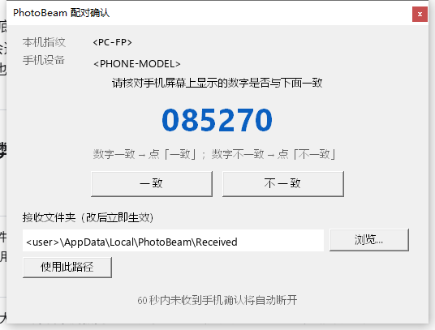
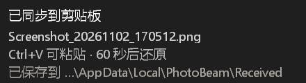

# PhotoBeam 使用手册（按步骤走）

> 手机截图 / 图片 → 局域网 → Windows 剪贴板。**数据不出局域网，不经过任何云。**
>
> 本手册按「你实际会做什么」编排。每一步都写明：**你要点哪里 → 你会看到什么 → 意味着什么**。
> 遇到和手册不一致的现象，见 [§5 出问题时](#5-出问题时怎么自查) 与 [§6 已知限制](#6-已知限制)。

---

## 0. 两端各是什么

| | 位置 | 你会看到它 |
|---|---|---|
| **手机端** | Android 13+ 的 App | 桌面上的深色方块 + 白色空心 **P** 图标；状态栏里的白色 **P** 图标 |
| **电脑端** | Windows 10+ 的 `PhotoBeam.exe` | 右下角系统托盘（可能藏在 `^` 溢出区里）里的深色方块 + 空心 **P** |

**关键约定**：

- 状态栏 **P 亮白** = 已连上电脑，同步可用；**P 变暗** = 服务在跑但没连上（电脑没开 / WiFi 不通）。
- P **始终在**（只要服务在跑）。它不会因为"没连上"就消失——消失才说明服务真的没起来。
- 托盘图标和手机状态栏图标是**同一个 P**，只是平台不同。

---

## 1. 第一次使用（两端从零开始）

### 步骤 1 · 电脑上先装好

1. 双击 `PhotoBeam.exe`。
2. **会弹一次 Windows 的 UAC 确认框**（标题类似"Windows 安全中心"），问是否允许此应用更改防火墙。
   → 点**「是」**。这一步在给 TCP 5416-5436 / UDP 5416 开入站规则，**不点的话手机连不上**。
3. **屏幕上不会出现任何主窗口**——这是正常的，它是个托盘程序。
4. 看**右下角系统托盘**：应该出现一个深色方块 + 空心 P。可能藏在 `^` 溢出区里，点开箭头能看到。
5. 鼠标悬停在托盘图标上，会看到一行 tooltip：
   `PhotoBeam 接收器 · TCP 5416 · 指纹 xxxxxxxxxxxxxxxx`
   —— **这行 fingerprint 和手机配对时可能用得上，先记住。**

> 如果双击后**什么都没发生**（图标不出现）：多半是端口 5416-5436 被别的程序占着。
> 现在程序会弹一个错误框告诉你；如果连框都没弹出来，去
> `%LOCALAPPDATA%\PhotoBeam\logs\pc.log` 看最后几行。

### 步骤 2 · 手机上装 App

1. 安装 `PhotoBeam.apk`（首次安装需在系统里允许"安装未知来源应用"）。
2. 打开 App，**系统会立刻弹权限框**：照片 + 通知 → **都点「允许」**。
   - 照片权限如果弹三选一（Android 14+）：**选「允许访问所有照片」**。
     选「部分照片」的话，App 会一直提示你权限不全，而且只会同步你选中的那几张。
   - 通知权限**必须允许**，否则状态栏看不到 P 图标，也收不到"图片被拒绝"这类提示。

### 步骤 3 · 让 App 能在后台自己活下来（**别跳过**）

状态区会有一行 `后台常驻：未放行（后台自启会被拦）`，下面跟着一条 ⚠。

1. 点 **`⑤ 允许后台常驻（关闭电池优化）`**。
2. App 会跳到系统设置页（国产 ROM 可能是"应用管理 / 自启动管理"）。找到 **PhotoBeam**，选
   **「无限制」**（或"允许自启动" + "允许后台运行"）。
3. 回到 App，状态区应变成 `后台常驻：已放行（可后台自启）`。

> **为什么必须做**：不放行的话，**开机后** App 可能被系统挂起到下一次心跳，状态栏 P 会长时间不亮；
> 覆盖安装后的自动恢复也可能失效。做了这一步，后台自起才是稳的。

### 步骤 4 · 配对（两端都要看一眼）

1. 手机上点 **`② 配对电脑（核对 6 位数字）`**。
2. 状态区变成 `正在发现电脑…` → `已发现 <电脑名>，正在配对…`。
   - 如果变成 `未发现电脑`，按 [§5.1](#51-手机提示未发现电脑) 排查。
3. **电脑上会弹出一个配对确认窗**（屏幕中间的普通 Windows 对话框）：
   - 显示 **6 位数字**（大字，蓝色）
   - 上面是本机指纹，下面是手机设备名
   - 两个按钮：**「一致」** / **「不一致」**
   - 底部还能顺手改「接收文件夹」
   - **60 秒**内不操作会自动关闭（配对失败，PC 上会弹框告诉你）
   - **屏幕上只会出现这一个配对窗**：手机后台的自动重连**不会**再弹窗把你的窗口顶掉；
     如果你重复点「② 配对电脑」，旧窗口会被真正关掉、换成新的那个，屏幕上仍然只有一个。
4. **在手机上核对**：手机也会弹一个对话框，显示同样的 6 位数字。
   - 手机数字 == 电脑数字 → 在**手机**上点「一致」，电脑上也点「一致」。
   - 数字**不一致** → 两端**任意一端**点「不一致」，双方立即断开、不会配对。
     断开后手机上会显示**中文说明**（例如「配对被拒绝：两端显示的 6 位数字不一致。」），
     不会甩给你一段英文技术串。
   - **60 秒**没点 → 手机自动取消，电脑上也会弹框告诉你「配对超时」。
     （数字不一致通常意味着中间有第三方设备，别硬点一致。）
5. 配对成功：
   - 手机：`配对成功！截图/存图会自动同步到电脑。`
   - 电脑：弹出 `已与 <手机名> 完成配对`

   

   *配对向导窗实际长相：上面是本机指纹与手机设备名，中间是 6 位数字，下方「一致 / 不一致」两个按钮，
   底部还可以顺手改接收文件夹。*

> **如果你在电脑上没看到那个配对窗**，说明电脑端程序版本偏旧——重新下载/更新 `PhotoBeam.exe` 再来。

### 步骤 5 · 确认已经连上

- 手机状态区应显示：`电脑：<电脑名>` / `服务：运行中` / `状态栏图标：正常（前台服务）`
- 手机**状态栏**出现一个**白色空心 P**（在状态栏左侧，信号/WiFi 图标旁边）。

---

## 2. 日常使用

### 你只需要做一件事：**截图**

1. 手机上正常截图（音量键下 + 电源键，或系统截图手势）。
2. 什么都不用点。App 会在后台发现这张新图 → 排队 → 发到电脑。
3. **手机状态栏的 P 会短暂变成动画**（P 右边冒小圆点，转 4 帧）——这就是"正在传"。
4. 传到电脑后，**电脑右下角弹出一个小窗**：

   ```
   已同步到剪贴板
   20261102_153045_照片.jpg        ← 手机上的原始文件名
   Ctrl+V 可粘贴 · 60 秒后还原
   已保存到 C:\Users\<你>\AppData\Local\PhotoBeam\Received
   ```

   左边还有这张图的**缩略图**（宽图会按比例缩到 76px 以内）。

   

   *同步弹窗实际长相：左边缩略图，右上「已同步到剪贴板」，下面是手机上的原始文件名、
   还原倒计时，以及**落盘目录**（图一定会存到文件夹，剪贴板只是顺手给你贴）。*

5. 在电脑上 **`Ctrl+V`** 粘贴。弹窗点一下可以立刻关掉，不点 5 秒后自己消失。

### 存图（不是截图，是相册里的图）

- App 会同步**相册里的新图片**（不只是截图）——但只同步**新增**的，老图不会一股脑倒过来。
- 如果你刚拍了一堆连拍，它们会作为**一批**发出去。

### 60 秒还原是什么意思

- 电脑的剪贴板被照片占住 60 秒，超时后**自动还原成你原来的内容**。
- 如果这 60 秒里你自己复制了别的东西，**就不还原**（尊重你的操作）。
- 如果这台电脑当时**没有打开过任何剪贴板内容**，那就没有"原内容"可还原，弹窗会写
  `原内容无可还原，本次不还原`。

### 写进剪贴板的到底是什么

- 同时写入 **DIB**（位图，给 Word/画图这类程序用）和 **PNG**（给大部分现代程序用）。
- **不进** Windows 的 `Win+V` 历史，**不上**微软云剪贴板。
- 但注意：照片会**占用**剪贴板 60 秒，期间你手动复制的别的东西会让还原被跳过。

---

## 3. 电脑上能做什么（托盘菜单）

**左键和右键点托盘图标都是弹出同一个菜单。**

| 菜单项 | 作用 | 什么时候用 |
|---|---|---|
| **打开接收文件夹** | 打开 `Received` 目录 | 想直接拿文件（不上剪贴板） |
| **接收文件夹…** | **换一个保存位置** | 默认目录不想用了 / 想存到 OneDrive 以外的地方 |
| **重新配对** | 清空已配对设备记录 | 换手机、配对失败想重来、电脑重装过 |
| **导出诊断信息** | 生成诊断文本到 `%LOCALAPPDATA%\PhotoBeam\logs\diagnostics-*.txt` 并弹窗告知路径 | 排查问题；**不会碰你的剪贴板** |
| **修复防火墙规则** | 以管理员权限重建入站规则 | 换了 exe 路径、或防火墙规则丢了 |
| **开机自启（登录时启动）** | 勾选后写入当前用户的启动项 | 想开机登录后它就自动在 |
| **剪贴板同步：开/关** | 勾选 = 收到的图片同时写入系统剪贴板；取消勾选 = 只落盘、不碰剪贴板 | 不想让图片进剪贴板、或想临时恢复 |
| **剪贴板还原时长：30/60/120/300 秒** | 点击循环切换。超过这个时间没人复制别的东西，剪贴板就还回你原来的内容 | 想多留一会儿/少留一会儿 |
| **重启 PhotoBeam** | 重新启动接收端（自动释放端口再拉起） | 手动改过 `config.json` 之后 |
| **退出** | 退出 PhotoBeam | —— |

> 上面三个带「剪贴板」「重启」的入口**立即生效**，不用改 `config.json`、也不用重启。

> 托盘图标的 **tooltip** 永远显示当前实际生效的 TCP 端口和本机指纹——端口被占时会漂移到 54xx，
> tooltip 会跟着变。

> **选文件夹对话框长什么样**：Windows 经典的「浏览文件夹」对话框，左边是目录树（从「桌面」开始，
> 逐层展开到「此电脑」/磁盘/文件夹），右边是「新建文件夹 / 确定 / 取消」。
> 它会**盖在配对向导窗上面**（向导窗是置顶窗口，所以对话框必须明确以它为主人窗口）。
> 注意：这个对话框**不预选**当前接收目录、也**没有路径输入框**——要换到别处请逐层展开目录树；
> 配对向导窗里那个「接收文件夹」输入框 + 「使用此路径」按钮可以直接填路径（等价于直填）。

---

## 4. 手机上能做什么（App 界面）

| 按钮 | 作用 | 什么时候用 |
|---|---|---|
| **① 授权照片与通知访问** | 重新申请照片 / 通知权限 | 权限被撤销了；或照片只授权了一部分 |
| **② 配对电脑（核对 6 位数字）** | 走一遍配对流程 | 第一次用；换电脑；配对出问题时重来 |
| **③ 立即同步** | 立刻触发一次对账 + 发送 | 觉得"没传过去"，手动催一下 |
| **④ 启动 / 刷新后台同步服务** | 确保服务在前台服务态 | 状态区显示「降级（普通通知）」时点它恢复 |
| **⑤ 允许后台常驻（关闭电池优化）** | 跳系统设置加白名单 | 状态区显示「未放行」时点它 |
| **⑥ 停止同步服务** | 停掉后台服务 | 你不想让它在后台跑了 |
| **⑦ 导出诊断信息** | 生成诊断文件并给出路径 | 排查问题 |

**状态区 5 行分别是什么意思**：

| 行 | 含义 |
|---|---|
| `电脑：xxx` | 已配对的电脑名；显示"未配对"就是还没配过 |
| `待发送：N 张` | 队列里还没发出去的张数；持续增长说明**电脑连不上** |
| `服务：运行中 / 未运行 / 降级（仅闹钟）` | 后台服务状态 |
| `状态栏图标：正常（前台服务）/ 降级（普通通知）/ 无（服务未运行）` | 状态栏 P 是怎么撑着的 |
| `后台常驻：已放行 / 未放行` | 电池优化白名单状态 |

**最近同步**那一行会告诉你上次同步的结果（成功发了几张 / 为什么没发出去）。

**已到电脑：N 张（最近 照片名 19:32:17）**——这是**逐张**回执：N 是累计到电脑的张数，
后面是最近一张的文件名和时间，一眼能对上是不是刚拍的那张。
出现 **⚠ 最近失败：文件名（原因）** 表示最近有一张没送到（比如文件名被拒、磁盘满）。
成功送出一张后，这条失败提示会自动消失（它只反映当前状态，不是历史）。

---

## 5. 出问题时怎么自查

### 5.1 手机提示"未发现电脑"

按顺序查：

1. 电脑上的 `PhotoBeam.exe` **还在运行吗**？（托盘里有没有 P 图标）
2. 手机和电脑 **在同一个 WiFi** 吗？（插线 + WiFi 同时开着时，以太网和 WiFi 是两个网段，会互相找不到）
3. 防火墙规则还在吗？→ 电脑托盘 →「修复防火墙规则」
4. 电脑上托盘 tooltip 的 **TCP 端口**是不是 54xx（漂移过）？→ 手机「② 配对」时会用广播拿新端口，一般不用手填
5. 都不行 → 电脑托盘「导出诊断信息」，把文件发出来看

### 5.2 手机提示"待发送一直涨"

= 电脑端连不上（没开 / IP 变了 / 被防火墙拦了）。
先看手机状态栏 P 是**亮**还是**暗**：暗 = 服务在、没连上；先按 5.1 排查。

### 5.3 电脑没弹窗 / 弹窗说剪贴板写入失败

- 弹窗写「剪贴板被其他程序长期占用」→ 关掉占用剪贴板的程序（常见：远程桌面、截图工具、剪贴板管理器），重试。
- 图片**已经存到文件夹了**（弹窗第三行会写路径），所以图不会丢。

### 5.4 电脑弹窗显示的文件名带一串数字

那是**落盘名**（`<毫秒时间戳>_<原名>`，保证不重名）。弹窗第二行显示的是**手机上的原名**，
以原名为准。

### 5.5 状态栏 P 整个不见了

= **服务真的没在跑**（不是"没连上"）。按这个顺序试：

1. 打开 App → 看「服务：」那行 → 点 **④ 启动 / 刷新后台同步服务**
2. 还不行 → 看「后台常驻」是不是"未放行" → 点 **⑤**
3. 再不行 → 手机上点 **⑥ 停止同步服务**，然后重新打开 App（会重新拉起服务）

### 5.6 想看日志

- 电脑：`%LOCALAPPDATA%\PhotoBeam\logs\pc.log`
- 手机：`adb logcat -s PhotoBeam`（需要 adb）

---

## 6. 已知限制

| 限制 | 说明 |
|---|---|
| **只支持一台电脑** | v1 范围；换电脑要先「重新配对」 |
| **息屏可能迟到** | 息屏时系统会限制后台活动，图片最终会到，但可能要等系统放行（放行电池优化后明显改善） |
| **网络切换会阻断发送** | 手机连了另一个 WiFi（网关不同）会被判定"网络变了"，App 会提示你切回去，避免把照片发到错误的网络 |
| **剪贴板只有一个槽位** | 连着发多张时，后一张顶掉前一张；60 秒后有可能还原成**上一张 PhotoBeam 的图** |
| **弹窗不排队** | 连发多张只看到最后一张的弹窗（图片都在文件夹里） |
| **"还原失败"没有提示** | 剪贴板被占导致还原失败时只写日志，照片会留在剪贴板里，手动复制一次别的即可覆盖 |
| **Android 14+ 部分照片授权** | 选「部分照片」后只有那几张能同步；App 会提示你去改成「所有照片」 |
| **heic 无缩略图** | iPhone 拍的 heic 在 Windows 资源管理器里不显示缩略图，但内容没问题 |
| **PC 端诊断是纯文本** | 导出的是给人看的自由文本，不是结构化日志 |

---

## 7. 一分钟速查

```
首次：  电脑双击 exe → UAC 点「是」 → 看托盘有 P
        手机装 apk → 开 App → 权限全允许
        → ⑤ 加白名单（省电策略选「无限制」）
        → ② 配对 → 电脑出现 6 位码 → 两边核对 → 都点「一致」
日常：  手机截图 → 什么都不用做 → 电脑弹窗 → Ctrl+V
不灵：  手机 ①~⑦ 按需点；电脑托盘「导出诊断信息」
```
